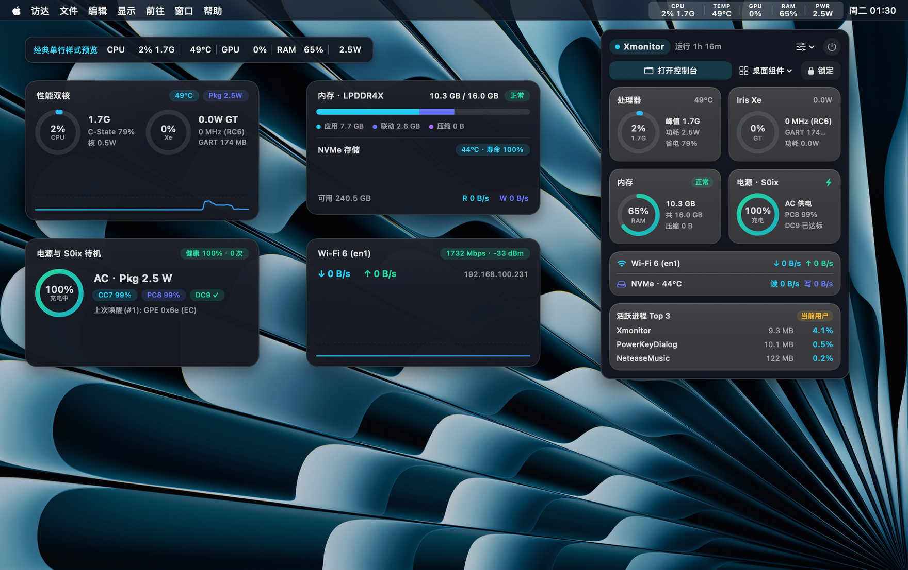
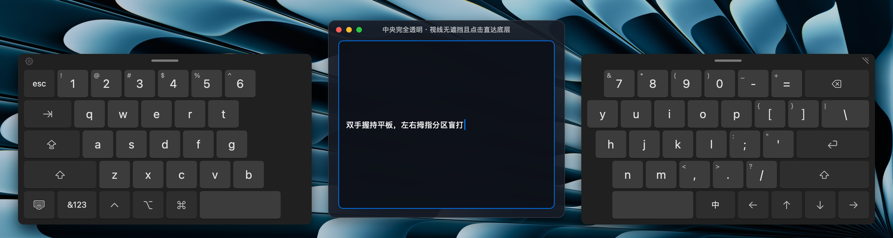
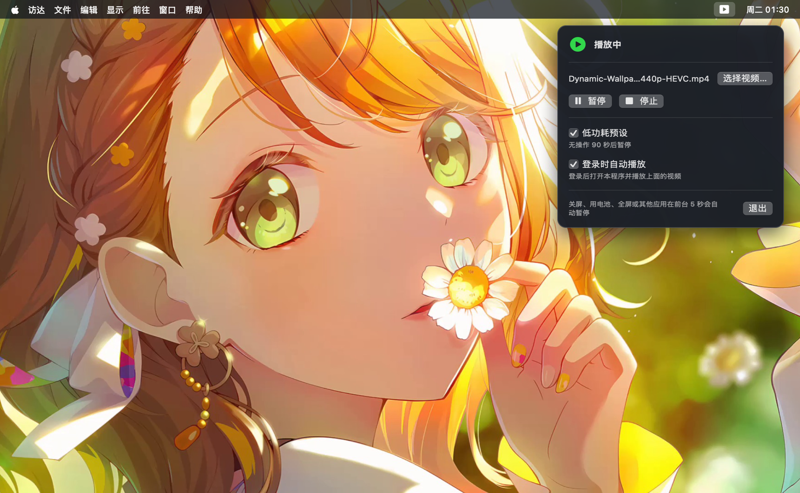

# X-STATION V2 Hackintosh（OpenCore）

i7-1165G7 / Iris Xe 二合一平板电脑上的 macOS Sequoia OpenCore EFI、ACPI 补丁和完整适配记录。

> **实验性项目。** 显卡与现代待机分别依赖社区驱动 [WhateverXe](https://github.com/b00t0x/WhateverXe)（0.8.2）和 [S0ixStandby](https://github.com/labrouss/S0ixStandby)（0.5.4）。
> 请先用 U 盘启动验证，保留原系统和数据备份。本项目与 Apple、Intel 及整机厂商无关。

当前版本：**EFI v2.0.1**（2026-11-17），macOS Sequoia 15.8.1（24H32），OpenCore 1.0.8，SMBIOS `MacBookPro16,2`。  
旧版 `v0.1.55`（禁用睡眠基线）已归档在 [`v1` 分支](../../tree/v1)。

## 硬件

| 项目 | 型号 |
|---|---|
| 机型 | X-STATION V2 |
| CPU | Intel Core i7-1165G7（Tiger Lake-UP3，4 核 8 线程，最高 4.7 GHz） |
| 内存 | 16 GB LPDDR4X-4267（8 × 2 GB Micron，四子通道 128-bit） |
| 显卡 | Intel Iris Xe `8086:9A49`（96 EU） |
| 屏幕 | 13.4" 3840×2400 eDP（Sharp `SHP14A8`），Wacom AES 触控与手写笔（`056A:48EE`，I²C HID） |
| 硬盘 | Kingston OM8PDP31024B-A01 1 TB PCIe x4 NVMe |
| 无线 | Intel AX201（Wi-Fi 6 + 蓝牙） |
| 音频 | Realtek ALC256 |
| 接口 | 2 × 雷电 4（按 USB-C + DP Alt Mode 使用）、1 × USB 3.2 Type-C |

详细的 PCI / ACPI / USB 身份见 [docs/hardware.md](docs/hardware.md)。

## 适配状态

| 设备 | 状态 | 说明 | 起始版本 |
|---|---|---|---|
| 核显加速 | ✅ | Metal（WhateverXe 0.8.2 + Graphics 0.4.4），3840×2400 面板按 2560×1600 HiDPI | B′ 基线 / v2.0 |
| 背光 / 关屏点亮 | ✅ | SSDT-PNLF + 核显真 `DC9` 断电冷唤醒（已移除 `-noDC9`） | v0.1.42 / v2.0 |
| 外接显示器 | ✅ | USB-C DP Alt Mode 视频输出正常（进入 S0ix 睡眠前建议先拔除外接屏） | v2.0.1 |
| 系统睡眠 | ✅ | S0ix 现代待机 Deep Idle（`CC7`/`PC8` 99% + 核显 `DC9`），电池支持电源键唤醒，插电支持整晚待机 | v2.0 |
| 触摸屏 | ✅ | VoodooI2C 2.9.1，10 点，GPIO 中断 | v0.1.41 / v0.1.52 |
| 手写笔 | ✅ | 悬停、笔尖、侧键、橡皮擦；应用内压感未验证 | v0.1.51 |
| 键盘 / 音量键 | ✅ | VoodooPS2（只用 Keyboard 插件） | v0.1.42 |
| 电源键 | ✅ | SSDT-PWRBEC + `PWRB.PRW0`；电池睡眠支持短按唤醒，亮屏短按弹关机面板配 `tools/powerkey` | v0.1.50 / v2.0 |
| 扬声器 / 耳机 / 麦克风 | ✅ | AppleALC layout 19 + coef `0x10` 扬声器开关 | v0.1.44 |
| Wi-Fi | ✅ | AirportItlwm（原生 Wi-Fi 菜单，S0ix 唤醒后自动重连） | v0.1.36 / v2.0 |
| 蓝牙 | 🟡 | 可用，登录前偶尔连不上 | v0.1.40 |
| 电池 | ✅ | 电量与充电状态；SSDT-BATFULL 修正 EC 94% 停充时的满电判定 | v0.1.42 / v2.0 |
| CPU 电源管理 | ✅ | XCPM + HWP，0.4–4.7 GHz；亮屏静置封装约 2.0 W，关屏空闲整机约 3.8 W（插座端） | — / v2.0 |
| NVMe | ✅ | NVMeFix + ASPM L1 | v0.1.53 |
| USB | ✅ | 实测定制映射（UTBMap） | v0.1.55 |
| 摄像头 ×2 | 🟡 | QuickTime 可用；Photo Booth 预览崩溃 | — |
| 读卡器 | ⬜ | 已识别，未插卡测试 | — |
| 雷电 | ❌ | 集成雷电（NHI PCIe 隧道）在 macOS 无驱动，接口按 USB-C + DP Alt Mode 使用 | — |
| 指纹 | ❌ | 无法适配 | — |

## 性能基准（v2.0，连续 9 次 S0ix 睡眠唤醒后实测）

以下数据均在开机运行超过 7 小时、经历 **9 轮 S0ix Deep Idle 睡眠唤醒及 9 次 `-s0ixgpureset` 核显硬件复位**后实测，确认睡眠唤醒后 CPU 与核显均无锁频或异常降频：

| 子系统 | 测试项目 | 实测结果 |
|---|---|---|
| **静置功耗** | 亮屏空闲（`powermetrics`） | CPU 封装 **1.99–2.22 W**，Package C-State 驻留 **90.5%–91.4%**，核显 RC6 **99.66%** |
| **CPU 频率与功耗** | 单核睿频 / 8 线程全核睿频 | 单核峰值 **4,665 MHz**（13.9–18.4 W）；8 线程持续 **3,936 → 3,848 MHz**（PL2 **38.5 W**） |
| **CPU 计算** | LibreSSL SHA-256（8 KB 块） | 单核 **458.9 MB/s**；8 线程 **1,664.3 MB/s**（3.63×） |
| **CPU 浮点 / 矩阵** | AVX2 FP64 FMA / Accelerate `sgemm` FP32 | FP64：单核 **57.7 GFLOPS** / 8 线程 **214.0 GFLOPS**；`sgemm`：单核 **122.9 GFLOPS** / 多线程 **387.5 GFLOPS** |
| **Iris Xe Metal** | FP32 Compute / 显存 Blit / 4K 渲染 | FP32 FMA **1.34 TFLOPS**（1,339 GFLOPS）；Blit 拷贝 **21.8 GB/s**（总读写 **43.6 GB/s**）；`3840×2400` 填充 **1,463 fps**（13.5 GPixel/s）、8 阶过程着色器 **789 fps**（7.3 GPixel/s） |
| **内存（LPDDR4X-4267）** | STREAM Triad（528 MB）/ 随机延迟 | 单线程 **21.3 GB/s** / 8 线程 **44.1 GB/s**；延迟 L1d **1.31 ns**、L2 **4.00 ns**、L3 **12.35 ns**、DRAM **131.7 ns** |
| **内置 NVMe（绕过缓存）** | 1 GB 顺序读写 / 4K 随机读（`F_NOCACHE`） | 顺序读 **1,790.3 MB/s**、顺序写（含 `fsync`）**1,540.0 MB/s**；4K 随机读 QD1 **13,467 IOPS**（74.3 µs）、8 线程 **100,480 IOPS**（411.6 MB/s） |

## 配套软件推荐（平板触控与低功耗场景定制）

针对本机 **二合一触控平板形态** 与 **Tiger Lake S0ix 现代待机低功耗要求**，配套开发并维护了以下三款原生 macOS 工具（均无需安装 `Xcode.app`，使用 Command Line Tools 即可编译）：

| 项目 | 定位 | 核心特性与本机联动优化 |
|---|---|---|
| **[Xmonitor](https://github.com/Akariayumu/Xmonitor)** | 原生硬件监控套件 | 顶部同色菜单栏 + 壁纸层常驻小组件 + 8 页签深度控制台。进程内零子进程直读 `APERF/MPERF` 真实频率、RAPL 封装/核显功率、`SMCProcessor` 温度、`S0ixStandby` 零 Forcewake 核显 MHz、SMC 实时充放电净流、NVMe SMART 与 S0ix `CC7 / PC8 / DC9` 驻留诊断；熄屏与睡眠自动降为 `0 Hz` 零唤醒，常驻 CPU `< 0.3%`。 |
| **[ScreenBoard](https://github.com/Akariayumu/ScreenBoard-for-Mac)** | 仿 Win11 触摸屏幕键盘 | 专为拆下磁吸键盘后的纯平板触控模式打造。浮动面板不抢当前窗口输入焦点，支持底部铺满停靠、自由浮动与左右分体拇指布局；虚拟键码直通系统原生拼音输入法，支持长按备选符号、按词删改移动与点按文本框自动弹出。 |
| **[Wallpaper4Mac](https://github.com/Akariayumu/Wallpaper4Mac)** | 低功耗动态视频壁纸 | 原生菜单栏管理端 + 静音硬解播放内核 + `hevc_videotoolbox` 硬件转码脚本。针对本机功耗与窗口看门狗做了激进省电联动：关屏、S0ix 睡眠、切电池供电、全屏应用或前台焦点离开桌面满 5 秒自动暂停视频解码，触摸或键鼠操作瞬间无感恢复。 |

| [Xmonitor](https://github.com/Akariayumu/Xmonitor)（菜单栏 · 桌面组件 · S0ix 控制台） | [ScreenBoard](https://github.com/Akariayumu/ScreenBoard-for-Mac)（平板触控分体屏幕键盘） | [Wallpaper4Mac](https://github.com/Akariayumu/Wallpaper4Mac)（智能暂停低功耗动态壁纸） |
| :---: | :---: | :---: |
|  |  |  |

## 已知问题

- **插电与电池采用分离睡眠策略（`pmset` + `tools/powerkey`）。** 本机 `H_EC` 电池/Type-C PD 心跳与电源键 `PWRB` 共用 `GPE 0x6E`，即使充满至 100% 插电状态下 EC 仍会每分钟周期性触发一次 `GPE 0x6E`：因此 `-s0ixacnoecwake` 在插电时全程屏蔽 `GPE 0x6E` S0 唤醒防误亮屏，同时配套的 `tools/powerkey`（`PowerKeyDialog`）持有仅对插电生效的 `PreventSystemSleep` 断言——插电时无论闲置还是手动点击「苹果菜单 → 睡眠」均进入仅关屏省电态（`~3.8 W`，支持电源键与触摸屏随时秒亮，绝不误唤醒）；一旦拔掉充电器切回电池模式，`powerd` 自动忽略该断言并放行进入真 S0ix Deep Idle（`PC8 99%` + `DC9`，自动恢复实体电源键唤醒）。
- **长时睡眠唤醒后 Wi-Fi 约需 25–35 秒自动重连。** 短时睡眠唤醒后 Wi-Fi 通常数秒内恢复；经历数小时平台 S0ix 深睡唤醒后，`AirportItlwm` 重新初始化 AX201 固件并完成 WPA2 关联约需 25–35 秒。
- **高负载视频壁纸与远程桌面截屏叠加偶发 GPU 重启。** 动态壁纸（WebKit 播放视频）与远程桌面截屏同时运行时，早期版本出现过 `GPURestart` → `WindowServer` 看门狗超时。日常避免两者长时间叠加运行。
- **触摸驱动极低概率空指针 panic**：VoodooI2C 在 `forwardReport` 中读 `IOFBTransform` 时没有判空，很少触发。
- **Photo Booth 打开预览即崩溃**，相机预览和录像请用 QuickTime。

## 版本历史

每个版本只改一个变量或一组紧耦合机制。[CHANGELOG.md](CHANGELOG.md) 只收录有实际突破的版本，每条写明当时卡在哪里、解决思路和具体改动。下面是主线：

| 阶段 | 版本 | 卡在哪里 | 怎么解决的 |
|---|---|---|---|
| 引导 | v0.1.0–v0.1.15 | `EXITBS:START` 卡死；Recovery 里键鼠无效 | 按同 CPU 的 Yoga 13ITL5 对齐 quirks（v0.1.11）、无 MAT 的 Booter 组合（v0.1.14）、USBToolBox 临时映射（v0.1.15） |
| 显示（Tahoe） | v0.1.16–v0.1.33 | WindowServer 在 `SetupTimings` / watermark 计算里除零 panic | AGDC 回调失败后时序没初始化；WhateverXe 补丁写回已验证的 4K 时序（v0.1.33） |
| 加速（Tahoe） | v0.1.34–v0.1.35 | WindowServer 每 9 秒崩溃（`Xe compiler unsupported bitcode layout`） | 着色器转换器不支持 CoreAnimation 的一个变体，改回 Sequoia |
| 加速（Sequoia） | B′ 基线 | 官方 0.5.0 在 Sequoia 同样除零 | 时序修复移植到 Sequoia，4K + Metal 2 稳定 |
| 外设 | v0.1.36–v0.1.41 | 无 Wi-Fi / 蓝牙 / 声音 / 触摸 | AirportItlwm、Intel 蓝牙套件、AppleALC、VoodooI2C |
| 关屏点亮 | v0.1.42 | 关屏后黑屏，链路训练失败 | 面板断电会丢失 DPCD `0x115` 速率表；训练前写回（`-wex-sink-rate-restore`） |
| 扬声器 | v0.1.43–v0.1.45 | 耳机有声，扬声器无声 | Linux 反向验证：ALC256 coef `0x10` bit9 是扬声器静音位，写进 layout 19 |
| 电源键 | v0.1.46–v0.1.50 | macOS 下按电源键没有任何事件 | EC 地址空间没被读过就不发 Query `0x54`；`_REG` 时补读一遍 EC RAM |
| 手写笔 | v0.1.51–v0.1.52 | 笔数据被丢弃；触摸退回 5 ms 轮询 | VoodooI2C 2.9.1；上游 CI 版 VoodooGPIO（Tiger Lake LP） |
| 功耗 / USB | v0.1.53–v0.1.55 | 关屏功耗偏高；USB 用的是临时全开映射 | NVMeFix；逐口插拔实测生成 UTBMap（归档为 `v1` 分支） |
| **S0ix 现代待机** | **v2.0** | 无传统 S3；核显禁了 DC9 阻塞深睡；插电 94% 停充与 `GPE 0x6E` 充电脉冲导致秒醒 | 升级 WhateverXe 0.8.2 实现真 `DC9` 冷唤醒；`SSDT-DEEPIDLE` + `S0ixStandby 0.5.4` 打通 `SleepType=7` 与 GT 硬件复位；`SSDT-BATFULL` + `-s0ixacnoecwake` 解决插电整晚待机 |

### 按症状查

| 你遇到的现象 | CHANGELOG 里看 |
|---|---|
| 卡在 `EXITBS:START` | v0.1.11：拿同 CPU 能用的 EFI 成组对齐 quirks |
| 进内核后 page fault / 重启 | v0.1.14：固件不支持 MAT 时用无 MAT 的 Booter 组合 |
| Recovery / 安装界面键鼠没反应 | v0.1.15：USBToolBox + 临时全开映射 |
| `SetupTimings+0x159` 或 `computeWatermarkValue` 除零 panic | v0.1.33、B′ 基线：写回已验证的时序 |
| 开机偶发 `setupPipeWatermarks` panic、关屏后 `PG2 power well` panic | 未编号（10-27）：时序保护与电源井轮询 |
| 关屏或睡眠唤醒后内屏黑屏 | v0.1.42、v2.0：WhateverXe 0.8.2 真 `DC9` 冷恢复 + 写回 DPCD `0x115` |
| 睡眠直接死机、不进深睡或唤醒后核显冻死 | v2.0：`SSDT-DEEPIDLE`（`SleepType=7`）+ `S0ixStandby`（`-s0ixgpureset -s0ixrefclk -s0ixd3`） |
| 电池睡眠按电源键叫不醒，或插电入睡后被充电脉冲秒醒 | v2.0：`PWRB.PRW0` 补 `GPE 0x6E` + `SSDT-BATFULL` + `-s0ixacnoecwake` |
| 亮度滑块无效 | 未编号（10-27）：SSDT-PNLF 挂在 `\_SB.PC00.GFX0` |
| layout 改了不生效、扬声器无声 | v0.1.44：`alcapplid` 与 coef `0x10` |
| 电池不显示 | 未编号（10-26）：SMCBatteryManager **加** ECEnabler |
| 亮屏下按电源键无事件 | v0.1.50：`_REG` 时读一遍 EC RAM |
| 笔不工作 | v0.1.51：VoodooI2C 2.9.1 |
| 触摸 CPU 占用高（轮询） | v0.1.52：Tiger Lake LP 的 VoodooGPIO |

## 目录

```text
EFI/                      OpenCore EFI（v2.0）。第三方文件由脚本补齐，见下
  OC/config.plist         已脱敏：SMBIOS 是占位符，不能直接启动
  OC/ACPI/                本机 8 张 SSDT（AML）
  OC/Kexts/UTBMap.kext    本机实测 USB 端口映射
  OC/Kexts/XSHIDDLog.kext 本项目的 HIDD 日志 kext（源码在 src/）
  OC/Kexts/WhateverXe.kext            WhateverXe 0.8.2 + 本项目补丁的编译结果
  OC/Kexts/S0ixStandby.kext           S0ixStandby 0.5.4 + 本项目补丁的编译结果
  OC/Kexts/VoodooI2C.kext/.../VoodooGPIO.kext  上游 CI 构建（GPL-3.0，见 THIRD_PARTY.md）
  OC/Kexts/{AppleALC,VoodooI2C}.kext/Contents/Info.plist  在上游版本上改过的 Info.plist
acpi/                     SSDT 源码（.dsl），编译结果与 EFI 中的 AML 逐字节一致
patches/WhateverXe/       WhateverXe 0.8.2（及旧版 0.5.0）补丁、构建脚本与许可证
patches/S0ixStandby/      S0ixStandby 0.5.4（-s0ixacnoecwake）补丁、构建脚本与许可证
src/XSHIDDLog/            XSHIDDLog.kext 源码
scripts/fetch-thirdparty.sh  下载并校验第三方组件，补齐 EFI
thirdparty.lock           第三方发布包的 URL / SHA-256，以及每个文件的来源
EFI-sha256.txt            v2.0.1 EFI 中全部 66 个文件的 SHA-256（config.plist 除外）
tools/                    实用工具（tools/s0ix 确定性 U 盘构建与 DSDT 校验、电源键面板、USB/手写笔/电池工具）
docs/                     硬件信息、各子系统调查记录与 S0ix 路线图
CHANGELOG.md              各次突破的问题、思路和改动
THIRD_PARTY.md            第三方组件、版本和许可证
```

## 使用方法

1. **补齐第三方组件。**

   ```bash
   scripts/fetch-thirdparty.sh
   ```

   脚本从各项目的 GitHub 发布页下载 14 个固定版本的发布包，逐个校验 SHA-256，取出 46 个文件放进 `EFI/`，
   最后按 `EFI-sha256.txt` 校验 EFI 里全部 66 个文件。通过后得到的 EFI 与作者实机使用的 **v2.0.1** 逐字节一致
   （`config.plist` 除外）。Linux 和 macOS 都能运行。

2. **生成自己的 SMBIOS。** 用 [GenSMBIOS](https://github.com/corpnewt/GenSMBIOS) 生成 `MacBookPro16,2`
   的序列号、MLB、SystemUUID，填进 `config.plist` 的 `PlatformInfo → Generic`；ROM 填本机网卡 MAC。
   **不要使用别人的序列号。**

3. **BIOS 设置。** DVMT Pre-Allocated 设为 96 MB；关闭 Secure Boot。

4. **先用 U 盘启动。** 把 `EFI` 放到 U 盘的 FAT32 分区上（也可使用 `tools/s0ix/stage_usb_efi.py` 生成强制 `WriteFlash=False` 的测试 U 盘）。首次安装 macOS 时显卡还没有系统端驱动，先在 `boot-args` 里临时加上 `-wex-noaccel`，装好图形包后再去掉。

5. **安装 WhateverXe Graphics 0.4.4。** 进入 macOS 后按
   [WhateverXe Graphics](https://github.com/b00t0x/WhateverXe-Graphics) 的说明安装 **v0.4.4** 图形包（装进系统，不在 EFI 里）。
   SIP 已按要求设为 `0x803`。

6. **配置 `pmset` 睡眠参数（插电仅关屏 + 电池 S0ix 深睡）。** 进入系统后执行一次：

   ```bash
   sudo pmset -a disablesleep 0 hibernatemode 0 standby 0 autopoweroff 0 powernap 0 tcpkeepalive 0 proximitywake 0 womp 0
   sudo pmset -c sleep 0 displaysleep 5
   sudo pmset -b sleep 5 displaysleep 5
   ```

7. 确认睡眠唤醒与显示正常后，再考虑把 EFI 写入内置硬盘。作者把它放在内置硬盘上一个独立的 FAT32 分区里，没有改动 Windows 的 ESP。

### 启动参数

| 参数 | 作用 |
|---|---|
| `alcid=19 alcapplid=19` | AppleALC layout 19。只写 `alcid` 不够，AppleHDA 实际用的 layout 由 `alcapplid` 决定 |
| `-allow3d -disablegfxfirmware` | WhateverXe 要求：打开 3D 路径，不加载 GuC 固件 |
| `-wex-tgl-sdt-guard` | 本项目 WhateverXe 补丁：Tiger Lake 4K 显示时序保护（防止除零 panic） |
| `-wex-no-panel-keep -wex-sink-rate-restore` | 本项目 WhateverXe 补丁：允许关屏与 `DC9` 期间面板断电，点亮训练前自动写回 DPCD `0x115` 速率表 |
| `-nodisplaysleepDC6` | 仅在亮机单纯关屏时不进 `DC6`，系统睡眠仍正常进入更深的真 `DC9` |
| `-s0ixgpureset` | S0ixStandby：S0ix 唤醒瞬间执行 Tiger Lake GT 硬件复位（`GEN11_GDRST`） |
| `-s0ixrefclk -s0ixd3` | S0ixStandby：睡眠期间释放 PCIe 参考时钟并将无驱动 PCI 设备（ISH、TBT DMA、LPSS、DPTF 等）切入 `D3hot`，解除 `SLP_S0` 阻塞进入 `PC8` 深睡 |
| `-s0ixacnortc` | S0ixStandby：插电无用户显式定时任务时抑制系统自动维护型 RTC 唤醒 |
| `-s0ixacnoecwake` | 本项目 S0ixStandby 补丁：插电时屏蔽 `PWRB` 共享 `GPE 0x6E` S0 唤醒防 EC 周期心跳误亮屏，拔电切回电池模式时自动恢复实体电源键唤醒 |
| `-v keepsyms=1 debug=0x100` | 调试符号与详细引导输出，稳定后可按需精简 |

### ACPI

| SSDT | 作用 | 配套 DSDT 改名 |
|---|---|---|
| SSDT-RTCAWAC | 关 AWAC、启用传统 RTC | — |
| SSDT-PLUG | CPU 电源管理（`plugin-type=1`） | — |
| SSDT-EC | macOS 下让原有的 `H_EC` 保持启用，另加占位设备 `EC` | `H_EC._STA → XSTA` |
| SSDT-PNLF | 内屏背光控制，挂在 `\_SB.PC00.GFX0` | — |
| SSDT-PWRBEC | 电源键事件：`_REG` 时预读一遍 EC RAM 激活 SCI 查询 | `H_EC._REG → XREG` |
| SSDT-HIDDSTA-v2 | macOS 下打开 Intel HID 事件设备 | `HIDD._STA → XSTA` |
| SSDT-DEEPIDLE | 开启 `LPS0` / `LXEN`，Darwin 下暴露 `PEPD` 并为 `PWRB` 声明 `PRW0`（`GPE 0x6E`） | `_S3_ → XS3_`、`PEPD._STA → XSTA` |
| SSDT-BATFULL | Darwin 下修正 EC 在 ≥94% 停充时的电池满电报告，不写 EC RAM | `BAT0._BST → XBST` |

## 本项目的主要工作

- **显示与真 DC9 冷唤醒**：将 Tiger Lake 4K 显示时序保护和面板速率恢复迁移到 WhateverXe 0.8.2（[patches/WhateverXe](patches/WhateverXe)），移除 `-noDC9` 实现真 `DC9` 睡眠断电与冷训练点亮。
- **S0ix 现代待机（电池 + 插电双模）**：通过 `SSDT-DEEPIDLE` 与 `S0ixStandby` 0.5.4 打通 `SleepType = 7`（`CC7`/`PC8` 99%）与核显硬件复位；编写 `SSDT-BATFULL` 与 `-s0ixacnoecwake`（[patches/S0ixStandby](patches/S0ixStandby)）解决 94% 停充判定与插电 `GPE 0x6E` 误唤醒，配套提供确定性 U 盘构建与 DSDT 二进制校验工具（[tools/s0ix](tools/s0ix)）。
- **电源键**：查明按键时 EC 不发 SCI 是因为 EC 地址空间没被访问过，`SSDT-PWRBEC` 补一次读取即可；在 `SSDT-DEEPIDLE` 中补齐 `PWRB.PRW0` 支持电池睡眠电源键唤醒。
- **音频**：通过 Linux 反向验证，找到 ALC256 coef `0x10` bit9 是扬声器开关，写进 AppleALC layout 19。
- **触摸与手写笔**：VoodooI2C 2.9.1 加本机 I²C 控制器（`0xa0e88086&0xFFFCFFFF`）匹配，配合 Tiger Lake LP 的 VoodooGPIO 中断驱动。
- **USB**：逐口插拔实测，生成 USBToolBox 定制映射。

## 许可证

本仓库自己的代码、ACPI 补丁、构建工具和文档使用 [BSD 3-Clause](LICENSE)。

第三方组件见 [THIRD_PARTY.md](THIRD_PARTY.md)。大部分第三方二进制不放进仓库，由脚本从上游下载。
仓库里包含四类第三方派生文件：`WhateverXe.kext`（BSD-3-Clause，补丁与版权声明在 `patches/WhateverXe/`）、
`S0ixStandby.kext`（BSD-3-Clause，补丁与版权声明在 `patches/S0ixStandby/`）、
上游 CI 构建的 `VoodooGPIO.kext`（GPL-3.0，附许可证全文和对应源码版本），以及改过的 `AppleALC` / `VoodooI2C` 的 `Info.plist`。
WhateverXe Graphics 的图形驱动是 Apple / Intel 的二进制，请从其项目获取，本仓库不分发。

## 致谢

[Acidanthera](https://github.com/acidanthera)（OpenCore、Lilu、VirtualSMC、AppleALC、NVMeFix 等）、
[b00t0x/WhateverXe](https://github.com/b00t0x/WhateverXe)、[labrouss/S0ixStandby](https://github.com/labrouss/S0ixStandby)、
[VoodooI2C](https://github.com/VoodooI2C/VoodooI2C)、[OpenIntelWireless](https://github.com/OpenIntelWireless)、
[laobamac/itlwm](https://github.com/laobamac/itlwm)、[USBToolBox](https://github.com/USBToolBox)、
[1Revenger1/ECEnabler](https://github.com/1Revenger1/ECEnabler)、[Dortania](https://github.com/dortania)。
