# X-STATION V2 攻克 macOS S0ix (Modern Standby / Deep Idle) 技术路线图

**日期**：2026-11-15  
**分支**：`feat/s0ix-roadmap`  
**适用机型**：X-STATION V2 二合一平板（Intel Core i7-1165G7 `8086:9A49` Tiger Lake-UP3 GT2 96 EU / Sharp `SHP14A8` `LQ134R1JX45` 3840×2400@60Hz eDP 1.4 内屏）  
**基线版本**：EFI `v0.1.55` / macOS Sequoia `15.8.1` (`24H32`, Darwin `24.6.0`) / OpenCore `1.0.8` / SMBIOS `MacBookPro16,2` (`Mac-5F9802EFE386AA28`)  
**当前睡眠状态**：生产环境通过 `pmset -a SleepDisabled 1 sleep 0 hibernatemode 0 standby 0 autopoweroff 0 powernap 0` 全局禁用系统睡眠，仅依赖显示器休眠（亮屏空闲 `~5.3 W` → 关屏空闲 `~3.8 W`）

---

## 1. 执行摘要、量化目标与安全铁律

### 1.1 核心工程定性：为何唯一正道是 macOS 原生 Deep Idle (`IOPMSystemSleepType = 7`)

基于本机固件 ACPI 表、Linux 实机电源证据与驱动源码的交叉核验，X-STATION V2 的睡眠技术路线在物理层与内核层均已完全收敛：

1. **硬件平台原生定性为 S0ix (Modern Standby)**：
   - 主板 `FACP` (FADT) `Flags = 0x0023c4f5` 的 **bit 21 (`LOW_POWER_S0_IDLE_CAPABLE`) = `1`**，固件明确宣告平台以低功耗 S0 空闲（S0ix）替代传统 S3 挂起。
   - Linux 实机 `/sys/power/mem_sleep` 输出为 **`[s2idle] deep`**（默认激活 `s2idle`），且 ACPI 表具备完整的 **`LPIT`**（Low Power Idle Table，`SLP_S0` 硬件驻留计数器位于 `PWRMBASE + 0x193C = 0xFE00193C`，32-bit，`8197 Hz`）与 **`\_SB.PEPD`**（Power Engine Plug-in Device，`_HID = "INT33A1"` / `_CID = EisaId("PNP0D80")`）。
2. **传统 S3 (`SleepType = 3`) 与 S4 休眠 (`hibernatemode = 25`) 均为死路**：
   - **传统 S3 不可行**：尽管 BIOS `DSDT` 遗留了未门控的 `Name (_S3, ...)`（`dsdt.dsl:5856`），但主板 EC、Combo PHY A 与 Tiger Lake 供体核显驱动均无 S3 断电重初始化固件支持；一旦触发 `_S3`（写入 `SLP_TYP = 5`），整机立即陷入不可唤醒黑屏，只能长按电源键强制断电。
   - **S4 Hibernation (`hibernatemode 3 / 25`) 不可行**：`WhateverXe` 源码（`0.5.0` 至 `0.8.2`）不含任何 `IOHibernate` 镜像恢复钩子（`systemWillShutdown`、VRAM/GTT 重建或 `HibernationFixup` 协同逻辑），从 `sleepimage` 恢复必崩核显上下文，本路线图明确将 `hibernatemode = 0` 定为常量。
3. **macOS 原生 S0ix 通路已具备成熟工程拼图**：
   - 本机现役 SMBIOS **`MacBookPro16,2` (`Mac-5F9802EFE386AA28`)**（[EFI/OC/config.plist](../../EFI/OC/config.plist#L1031-L1032)）是 Apple Ice Lake 原生 S0ix 机型，内置完整的 `IOPlatformSystemSleepPolicy`（`SLPT` v2，328 字节）与 `UnifiedSleepSliderPref = true`。
   - 本机已启用 **Ice Lake CPUID 仿冒**（`0x000706E5`，`Cpuid1Data = 5QYHAAAAAAAAAAAAAAAAAA==`，[EFI/OC/config.plist](../../EFI/OC/config.plist#L735-L742)）与 `AppleXcpmCfgLock = true`（[EFI/OC/config.plist](../../EFI/OC/config.plist#L758-L759)），XCPM 原生支持深达 **Core C7 / Package C10 (`PC10`)** 的 MWAIT 子状态（`CPUID.5:EDX = 0x11121020`）。
   - 2026 年 11 月社区已在与本机同款 SoC（`i7-1165G7` / `i7-1185G7` `8086:9A49` + macOS Sequoia `15.8.1`/`15.8.2` + `WhateverXe 0.8.2` + `S0ixStandby v0.5.4`）上实测跑通 **`IOPMSystemSleepType = 7` + `99% PC10` + `0.6–1.0 W` 过夜待机**。本机只需精准跨越下述 **5 大机型特化瓶颈**（尤其是本机独有的 `PEPD._STA = 0` 隐藏陷阱、Sharp 4K `DPCD 0x115` 面板链路恢复与二合一平板 EC 电源键唤醒拓扑），即可系统性攻克 S0ix。

### 1.2 终态量化验收指标（Exit Criteria）

| 维度 | 指标项 | 当前基线（`SleepDisabled=1`） | 终态目标阈值（准产门禁） |
| :--- | :--- | :--- | :--- |
| **XNU 睡眠策略** | `IOPMDeepIdleSupported` / `IOPMSystemSleepType` | 未启用 / 无睡眠 | `Yes` / **`7` (`kIOPMSleepTypeDeepIdle`)** |
| **CPU 封装驻留** | 单次 ≥15 min 睡眠 `PC10` 驻留率（MSR `0x632`） | `0%`（亮屏/关屏 S0 活跃） | **≥ 85%**（目标 **95%–99%**） |
| **PCH 硬件驻留** | LPIT `SLP_S0` 驻留率（`0xFE00193C`） | `0%` | **> 70%** |
| **显示引擎睡眠态** | `DC_STATE_EN` (`0x45504`) / `PWR_WELL_CTL2` (`0x45404`) | `0x0`（`-noDC9` 锁死 DC0） | **`0x8` (DC9)** / **`0x0` (Power Wells Off)** |
| **整机待机功耗** | 关屏稳态待机功耗（Type-C 功率计 / 电池放电斜率） | 关屏 `~3.8 W`（8h 掉电 ~65%） | **< 1.5 W**（目标 `0.7–1.1 W`，8h 掉电 `< 10%`） |
| **4K 内屏唤醒** | Sharp `SHP14A8` 点亮耗时与时序 | 仅 Display Wake 正常 | **≤ 3 s** 恢复 `3840×2400 @ 60 Hz` (`592.5 MHz`, `DPCD 0x115 = 0x06` `5.4 Gbps`)，无黑屏/闪屏/花屏 |
| **Metal 3D 存活** | 唤醒后 Metal Render / Compute / VideoToolbox 硬解 | 未经系统睡眠检验 | 连续 20 次带载睡眠唤醒 **0 次 `GPURestart`**、**0 次 `EL-null` panic** |
| **平板交互与循环** | 物理电源键唤醒 + 触控/手写笔/Wi-Fi/BT/NVMe + 过夜压测 | 电源键仅弹出关机框 | 物理电源键可靠睡/醒；**20 次短循环 + 离电/插电各 8h 过夜 0 死机** |

### 1.3 实验安全铁律（Zero-Brick Safety Contract）

> [!CAUTION]
> 在 Phase 0 至 Phase 4 全部验收门禁 100% 通过之前，**严禁向内置 NVMe 生产引导分区（`disk0s5` / `disk0s7` `OPENCORE`）写入任何实验配置**。所有调试必须在独立 FAT32 救援/实验 U 盘上完成。

1. **U 盘 EFI 物理隔离**：实验 U 盘完整克隆当前稳定版 `EFI/` 目录作为起点；每次仅变更单一阶段变量，保留一份已知可进桌面的稳定备份目录（如 `EFI-BASELINE/`）。
2. **强制关闭硬件 NVRAM 刷写（`NVRAM -> WriteFlash = false`）**：
   - 现役 [EFI/OC/config.plist](../../EFI/OC/config.plist#L963-L970) 配置了 `NVRAM -> Delete -> boot-args` 且 `WriteFlash = true`（[EFI/OC/config.plist](../../EFI/OC/config.plist#L1004-L1005)）。若实验 U 盘保持 `WriteFlash = true`，其实验 `boot-args`（如移除 `-noDC9` 或加入实验标志）会永久刷入主板 SPI Flash，一旦触发睡眠死锁可能污染内置 EFI 启动环境。
   - **铁律**：实验 U 盘 `config.plist` **必须设 `NVRAM -> WriteFlash = false`**（保留 `NVRAM -> Delete -> boot-args` 仅作用于当次内存引导）。如此一来，**拔掉 U 盘重启即 100% 恢复生产环境，零残留**。
3. **系统盘 `/Library/Extensions` 升级前双备份**：Phase 0 升级 `WhateverXe Graphics v0.2.0` → `v0.4.4` 前，必须先执行 `tmutil localsnapshot` 创建 APFS 本地快照，并将现役 `/Library/Extensions/AppleIntelTGL*` 完整打包备份至本地恢复目录；U 盘 OpenCore Picker 同时配置一键 `-wex-noaccel` 安全入口。
4. **多系统零干扰保证**：Windows 通过主板独立 UEFI Boot Entry 直接引导 `disk0s1`（绕过 OpenCore）；Linux 即使由 OpenCore 引导也默认使用 `[s2idle]`，且本路线图新增的全部 SSDT 逻辑均包裹在 `If (_OSI ("Darwin"))` 内部，对 Windows / Linux 100% 透明。

---

## 2. 系统睡眠链路架构与五大根因瓶颈剖析

### 2.1 macOS Deep Idle (`SleepType = 7`) 全栈时序图

```mermaid
flowchart TD
    A["用户按电源键 / 空闲超时 / pmset sleepnow"] --> B["IOPMrootDomain 评估策略<br/>_S3 已重命名为 XS3 + LPS0/LXEN=1 + MacBookPro16,2 SLPT<br/>选定 IOPMSystemSleepType = 7 (Deep Idle)"]
    B --> C["IOKit 驱动层逆序下电 setPowerState(0)<br/>1. VoodooI2C / AX201 / NVMe APST<br/>2. AppleIntelTGLGraphics (systemWillSleep)<br/>3. AppleIntelTGLGraphicsFramebuffer 进入 DC9 (0x45504=0x8, 断面板 VDD)"]
    C --> D["S0ixStandby: IOPlatformSleepAction (onSleep, 线程态)<br/>1. gpuSleep() 快照 HWS_PGA / GFX_MODE<br/>2. 调用 PEPD._DSM: Fn 3 (DisplayOff) -> Fn 5 (Entry)<br/>   执行 GUAM(1) + H_EC.ECNT(1) [CMSW 0x66,0xB5] + DPOF=1<br/>3. 若插电且开启 -s0ixacnortc: 清除 CMOS AIE 与 PM1_EN.RTC_EN"]
    D --> E["S0ixStandby: IOPlatformQuiesceAction (Boot CPU, 关中断)<br/>1. 若开启 -s0ixecwake: 置位 GPE0_EN 中 EC GPE 0x6E<br/>2. 快照 MSR C-state (PC2..PC10) + TSC + LPIT SLP_S0 (0xFE00193C)"]
    E --> F["XNU acpi_idle_kernel() -> pmCPUHalt(PM_HALT_SLEEP)<br/>LAPIC 保持使能, 除 SCI (IRQ 9) 外 IOAPIC 全部屏蔽<br/>SoC 进入 Package C10 + PCH SLP_S0 (< 1.5 W)"]
    F -->|"SCI 唤醒中断<br/>(RTC 闹钟 / EC GPE 0x6E _Q54 / XHCI)"| G["S0ixStandby: IOPlatformActiveAction (Boot CPU, 关中断)<br/>第一时间锁存 PM1_STS / GPE0_STS 唤醒源 + 采样 PC10 / SLP_S0 差值"]
    G --> H["S0ixStandby: IOPlatformWakeAction (onWake, 早于所有驱动唤醒)<br/>1. 恢复 RTC_EN, 保持 EC GPE 0x6E 使能<br/>2. 调用 PEPD._DSM: Fn 6 (Exit) -> Fn 4 (DisplayOn)<br/>   执行 GUAM(0) + H_EC.ECNT(0) [CMSW 0x65,0xA5] + DPOF=0<br/>3. gpuWake() -> gpuResetNow(): GEN6_GDRST (0x941C=1, ~60us) 干净复位 GT"]
    H --> I["IOKit 驱动层正序上电 setPowerState(1/2)<br/>1. AppleIntelTGLGraphics: wrapTGLCSBWake(head=11) + initModeRegisters(0x00080008)<br/>2. Framebuffer: prepareToEnterWake(0x25A4E) / recoverDPLink(0x3BB90) 分支 B<br/>3. WEX wrapTGLPortTraining 补写 DPCD 0x115=0x06 (5.4 Gbps) + T1 时序透传守卫 -> 4K@60Hz 点亮"]
```



---

### 2.2 瓶颈一：平台睡眠策略被 DSDT 无条件 `_S3` 劫持（Legacy S3 vs Deep Idle）

- **固件源码与二进制证据**：
  - 在反编译的 BIOS `DSDT`（`xstation-oc/work/acpi/dsdt.dsl:5849-5867`）中，`_S4` 受 BIOS 变量 `SS4` 门控，而 **`_S3` 被无条件暴露在根作用域下**：
    ```asl
    Name (_S0, Package (0x04) { Zero, Zero, Zero, Zero })
    Name (_S3, Package (0x04) { 0x05, Zero, Zero, Zero }) // dsdt.dsl:5856 —— 罪魁祸首
    ```
  - 同时，整张 `dsdt.dsl` 中 **不存在 `\_SB.LPS0`（`0` 处命中）与 `\_GPE.LXEN`（`0` 处命中）**。
  - 在此状态下，若直接将 `SleepDisabled` 设为 `0`，`AppleACPIPlatform` 不会向 `IOPMrootDomain` 发布 `IOPMDeepIdleSupported = Yes`（实机 `v33-root-ioreg.txt` 验证当前该属性为 `0` 处命中），而是优先匹配 `_S3`，选定 `IOPMSystemSleepType = 3`（传统 S3 挂起），导致机器一睡即死。
- **二进制唯一性核验（零误伤）**：
  - 对原始二进制表 `xstation-oc/work/acpi/dsdt.dat`（`359,989` 字节，`TableSignature = DSDT` / `RFNEVA==`，`OemTableId = "A M I \x00\x00"` / `QSBNIEkgAAA=`）及全部 19 张 `ssdt1.dat`..`ssdt19.dat` 进行全字节扫描：
  - `Name (_S3, ...)` 位于 `dsdt.dat` 偏移 **`0x6055`**，AML 字节流为 `08 5F 53 33 5F 12 07 04 0A 05 00 00 00`。
  - 5 字节特征串 **`08 5F 53 33 5F`**（Base64 `CF9TM18=`）在 `dsdt.dat` 中**全局唯一（`count = 1`）**，在 19 张 SSDT 中出现次数为 **`0`**。将其通过 OpenCore `ACPI -> Patch` 重命名为 `08 58 53 33 5F`（`Name (XS3_, ...)`，Base64 `CFhTM18=`），配合注入 `\_SB.LPS0` 与 `\_GPE.LXEN`，即可 100% 强制 XNU 走入 `IOPMSystemSleepType = 7` (`acpi_idle_kernel` → `pmCPUHalt(PM_HALT_SLEEP)`)。

---

### 2.3 瓶颈二：本机原生 `\_SB.PEPD` 在 Darwin 下因 `OSYS = 0x03E8` 被静默隐藏（`_STA = 0` 致命陷阱）

这是本次针对 X-STATION V2 固件与实机 `ioreg` 交叉审计发现的**最关键机型特化陷阱**：

- **原生 `\_SB.PEPD` 结构完备（严禁重复声明 `Device (PEPD)`）**：
  - `dsdt.dsl:49816-52978` 已完整定义 `Scope (\_SB) { Device (PEPD) }`，包含 `_HID = "INT33A1"` (`:49818`)、`_CID = EisaId("PNP0D80")` (`:49819`)、91 项设备低功耗约束包 `DEVY` (`:49894`，含 `\_SB.PR00..PR07` 与 `\_SB.PC00.GFX0` `:50018`)，以及完整的 Intel Low Power S0 Idle `_DSM`（UUID `c4eb40a0-6cd2-11e2-bcfd-0800200c9a66`，`:52122-52955`）：
    - **Fn `0`**：返回功能掩码 `Buffer { 0x7F }`（支持 Fn 1–6）。
    - **Fn `3` / Fn `4`**：屏幕关/开通知（当 `S0ID == 1` 时写 `D8XH` 调试端口）。
    - **Fn `5`（Sleep Entry，`:52919-52935`）**：执行 `GUAM(One)`（`:24314`，设置全局用户离开标志 `GLCK=1`、功率限制 `SPL1` 及音频 `PAUD.PUAM`）、**`^^PC00.LPCB.H_EC.ECNT(One)`**（`:7199`，置 `STEC = 1` 并向 CMOS 端口 `0x72/0x73` 写入 `CMSW(0x66, 0xB5)` 通知 EC 进入现代待机低功耗态），以及当雷电控制器 `TXHC` 存在时置 `^^PC00.DPOF = One`。
    - **Fn `6`（Sleep Exit，`:52937-52953`）**：逆序执行 `GUAM(Zero)`、**`^^PC00.LPCB.H_EC.ECNT(Zero)`**（置 `STEC = 0` 并写 `CMSW(0x65, 0xA5)` 唤醒 EC）与 `^^PC00.DPOF = Zero`。
- **为何上游 `S0ixStandby.kext` 直接放入本机会静默失效？**
  - 检查 `\_SB.PC00._INI`（`dsdt.dsl:24472-24521`）：系统初始化默认赋值 `Store (0x03E8, OSYS)`，仅当 `_OSI("Windows 2012")` 至 `_OSI("Windows 2015")` 为真时才将 `OSYS` 提升至 `0x07DC`–`0x07DF`。
  - 本机生产 EFI（[EFI/OC/config.plist](../../EFI/OC/config.plist#L15-L65)）**刻意不启用全局 `SSDT-XOSI`**（避免全局篡改 `OSYS` 影响 `I2C0`/`I2C1` 在 `dsdt.dsl:61556, 61661` 的总线时序及 `XHCI.DUAM` `:24388` 行为），故 macOS 下 `OSYS == 0x03E8`。
  - 而 `\_SB.PEPD._STA`（`dsdt.dsl:52111-52120`）的源码为：
    ```asl
    Method (_STA, 0, NotSerialized)
    {
        If (LOr (LGreaterEqual (OSYS, 0x07DF), LAnd (LGreaterEqual (OSYS, 0x07DC), LEqual (S0ID, One))))
        {
            Return (0x0F)
        }
        Return (Zero)
    }
    ```
  - 在 `OSYS == 0x03E8` 下，`PEPD._STA` 恒返回 **`Zero` (`0x00`)**！实机 `xstation-oc/private/v33-live/v33-root-ioreg.txt` 铁证显示：`PWRB`、`LID0`、`H_EC`、`BAT0` 均已注册，但 **`PEPD` / `PNP0D80` 在整个 IORegistry 中命中数为 `0`**！
  - 由于 `S0ixStandby.kext`（`v0.5.4`，纯 IOKit 驱动，无 Lilu）通过 `IONameMatch = ["PNP0D80"]` 挂载到 `IOACPIPlatformDevice`，若不放行 `PEPD._STA`，**`S0ixStandby.kext` 永远不会加载**，`PEPD._DSM`（EC 待机通知）与唤醒前的核显 `GEN6_GDRST` 复位将全部落空！
- **无副作用外科手术解法（沿用本机 `H_EC` / `HIDD` 同款 `XSTA` 模式）**：
  - 在 `dsdt.dat` 偏移 **`0x3B58D`** 处定位 `PEPD._STA` 方法头：`14 27 5F 53 54 41 00`（Base64 `FCdfU1RBAA==`）。经二进制全表校验，该 7 字节序列在 `dsdt.dat` 中**全局唯一（`count = 1`）**，在全部 19 张 SSDT 中为 **`0`**。
  - 将其重命名为 `XSTA`（`14 27 58 53 54 41 00`，Base64 `FCdYU1RBAA==`），并在 `acpi/SSDT-DEEPIDLE.dsl` 中与 `\_SB.LPS0`、`\_GPE.LXEN` 一并注入 `Scope (\_SB.PEPD) { Method (_STA) { If (_OSI ("Darwin")) { Return (0x0F) } Return (XSTA ()) } }`。既不重复定义 `Device (PEPD)`，也不污染全局 `OSYS`，精准唤醒原生 `PEPD` 供 `S0ixStandby.kext` 挂载。

---

### 2.4 瓶颈三：Sharp `SHP14A8` 4K eDP 1.4 内屏唤醒链路（`DPCD 0x115` 丢失、`B5` 唤醒分支与 `-noDC9` 悖论）

本机内屏 Sharp `LQ134R1JX45` (`SHP14A8`) 采用 **eDP 1.4 速率表索引选速**（`3840×2400 @ 60 Hz`，像素时钟 `592.5 MHz`；8 bpc 下 `592.5 MHz × 24 = 14.22 Gbps` 低于 4-lane HBR2 有效载荷 `17.28 Gbps`，而 `540 MHz` 仅为 10 bpc 上限）。其 `DPCD 0x010` 8 档速率表为 `1.62 / 2.16 / 2.43 / 2.7 / 3.24 / 4.32 / 5.4 / 8.1 Gbps`，固件通过向 **`DPCD 0x115` (`LINK_RATE_SET`) 写入索引 `0x06`（`5.4 Gbps` HBR2）** 锁定链路速率，在真 S0ix 下存在三层耦合约束：

1. **VDD 完全断电后的 `DPCD 0x115` 清零与源/屏速率失配**：
   - 在现役候选 11（`-wex-sink-rate-restore`，[patches/WhateverXe/README.md](../../patches/WhateverXe/README.md#L9-L13) 与 [patches/WhateverXe/candidate-11.patch](../../patches/WhateverXe/candidate-11.patch)）下，Apple 供体驱动正常写 `DPCD 0x100 = 0x1E`（HBR3；注：强制保持 `DPCD 0x100 = 0x00` 是已证伪淘汰的候选 10 `-wex-sink-rate-select`，开机即黑屏），同时由 **`XE::wrapTGLPortTraining`**（对应 `AppleIntelPort` 链路训练入口 `TGL330 port-training enter`）调用 `TGLSinkStateTrace::restore(0x115, want, 1, 3, read, write, wait)`（内置 **`tries = 3`、`IOSleep(1)` `1 ms` 间隔**的读-比-写-读回校验重试，结果记录于根注册表 `TGLSinkRestoreRate`）恢复固件留下的 `DPCD 0x115 = 0x06`（`5.4 Gbps`）。
   - 但在真 S0ix + DC9 彻底切断面板 VDD 电源轨并重上电后，面板 TCON 会将 `DPCD 0x115` 清零为 `0x00`，并将 `DPCD 0x001 / 0x2201` 改报 `0x1E`；若未及时写回 `0x115 = 0x06`，面板将按 `0x100 = 0x1E` 在 `8.1 Gbps` 接收，而源端以 `5.4 Gbps` 发送，导致时钟恢复（CR）失锁黑屏。Phase 2 需通过 `TGLSinkStateTrace` 与 `TGLSinkRestoreRate`（最高字节：`0` 已一致、`1` 写回成功、`2` 重试全败、`3` AUX 读失败）实机验证 DC9 冷上电后现有 `3 × 1 ms` 重试窗口是否充裕。
2. **`B5` 系统级唤醒分支校验（`prepareToEnterWake` `0x25A4E` / `recoverDPLink` `0x3BB90`）**：
   - 如 [wex-clean-rewrite-20261027.md](wex-clean-rewrite-20261027.md#L126-L200) 与 `xstation-oc/docs/wex-clean-rewrite/B5-WAKE-PATH-ANALYSIS.md` 逆向所示，`-wex-tgl-sdt-guard`（`TGLTimingGuard` / `T1`，`kern_tgl_timing_guard.hpp`）钩住 `AppleIntelFramebuffer::setupDisplayTiming(in, out)` (`0x6814C`)：当供体 AGDC 回调失败 (`0x68302`) 或索引越界 (`0x68328`) 未写入 `0xA0` 字节输出缓冲（引发下游 `SetupTimings` / `computeWatermarkValue` 除零 `#DE`）时，凭 `out + {0x28, 0x40, 0x50}` 的 `0xFE` 哨兵执行 `memcpy(out, in, 0xA0)`（等价于原生 `0x687F2` 透传）。
   - 然而 `setupDisplayTiming` 仅覆盖常规 `setDisplayMode` 路径；系统级睡眠唤醒走 `AppleIntelFramebufferController::prepareToEnterWake` (`0x25A4E`) 与 `recoverDPLink` (`0x3BB90`)，在进入外层 `hwSetMode` (`0x693EC`) 前存在三条分支：**分支 A1**（`idx == -1 && fb[0x1E6] != 0`）计算 `fb + 0x2A5 + (-1)*0x3DC` 造成 **`fb` 前向越界读取**；**分支 A2**（`idx >= 0 && fb[0x1E4] != 0`）从旧 AGDC 表槽 `fb + 0x259 + idx*0x3DC` 重建时序；**分支 B**（`fb[0x1E4] == 0 && fb[0x1E6] == 0`）调用 `validateDisplayMode(fb+0x4250)` 取得合法模式表项再传入 `hwSetMode`。
   - **利好基线证据**：`2026-10-27` 实机 `TGLWakeIndexLast` 遥测已证实本机 `fb+0x3FD8 = 0, fb+0x1E4 = 0, fb+0x1E6 = 0, fb+0x1EA = 0`，天然落入安全的 **分支 B**。按 `DONOR-CONTRACT.md` 约束，外层 `hwSetMode` (`0x693EC`) 仅作诊断观察而非拒绝点；若升级 `Graphics v0.4.4` 或真 S0ix 后 `TGLWakeIndexLast` 出现非零标志命中 A1/A2，预置兜底是在唤醒入口清理 `fb+0x3FD8` / `fb+0x1E4` / `fb+0x1E6` 强制归入分支 B（或在 `hwSetMode` 入口检测到零值 timing 时用 `validateDisplayMode` 结果回填）。
3. **`-noDC9` 与 `< 1.5 W` `PC10` 的硬性物理冲突（`WhateverXe#87` / `S0ixStandby` 实测铁律）**：
   - 现役 [EFI/OC/config.plist](../../EFI/OC/config.plist#L942) 携带 `-noDC9 -nodisplaysleepDC6`。
   - 实证表明：Sequoia TGL 供体驱动内置真实 Tiger Lake DMC 固件（`DMC_PROGRAM(0)` @ `0x80000`）；**保留 `-nodisplaysleepDC6` 完全不影响 S0ix**（亮屏/浅关屏无需 DC5/DC6），但**只要保留 `-noDC9`，核显 Display Engine 在 Deep Idle 期间就会被钉死在 DC0，导致 CPU 最高只能到 `PC8 (~51%)`、`PC10 = 0%`，睡眠整机功耗高达 `~7 W`**（甚至高于不睡眠仅关屏的 `3.8 W`）！
   - 反之，在无外接显示器且打通内屏唤醒恢复后，**移除 `-noDC9`** 可令 `AppleIntelTGLGraphicsFramebuffer` 在睡眠时原生切入 **DC9**（`DC_STATE_EN = 0x8`, `PWR_WELL_CTL1/2 = 0x0`），唤醒自动恢复 `0x0 / 0x3`，一举解锁 **`99% PC10` 与 `< 1.0 W` 待机功耗**。

---

### 2.5 瓶颈四：Tiger Lake Metal GT 渲染引擎唤醒崩溃与插电 DarkWake 死锁

1. **子瓶颈 4A — 12-entry CSB 唤醒读指针失步导致 `EL-null` 内核恐慌（`WhateverXe#80`）**：
   - **源码级机理**：在 `WhateverXe 0.8.2` 中，`XE::installTGLCSB12`（`WhateverXe/kern_xe.cpp:15113-15195`）修补 `IntelAccelerator::initModeRegisters`（`0x28E1A`，修补点 `0x28E45`）置位 `GFX_MODE` (`0x229C`) bit 3 = `1` 以启用 TGL 12-entry CSB，并将 `IGHardwareCommandStreamer5::resetOnWake` (`0x3A292`) 重定向至 **`XE::wrapTGLCSBWake`**（`kern_xe.cpp:15212`）→ 无条件调用 `tglCSBInitialize`（`kern_xe.cpp:15082-15090` / `kern_tgl_csb.hpp:176-186`），强行将软件 `state.head` 重置为 **`11` (`ResetIndex`)**、HWSP 槽位填满 `UINT64_MAX`，并写 MMIO CSB 指针 `0x0F0F0B0B`。
   - **崩溃触发条件**：在 S0ix Deep Idle 期间，开启 RC6 的 Tiger Lake GT 处于 RC6 保电态而**并未断电复位**，硬件引擎仍保留睡眠前的 `HWS_PGA` (`0x2080`)、`GFX_MODE = 0x8` 与睡眠前的真实 CSB 写指针（如 slot `3`）。唤醒后软件从 `(11 + 1) % 12 = 0` 开始读全 `0xFF` 的无效槽位，1–6 秒内首个 WindowServer / Metal 命令提交即触发 `IGHardwareCommandStreamer5` **`r113 EL-null` / `context-ID-mismatch`** panic！
   - **双轨根治方案**：
     - **主方案（Phase 3A，零驱动补丁）**：利用 **`S0ixStandby.kext v0.5.4` 在 Tiger Lake (`cpuModel == 0x8C`) 默认开启的硬件 `GEN6_GDRST` 复位**（`S0ixGPU.cpp:229-348`）。它在 `IOPlatformWakeAction`（早于 `AppleIntelTGLGraphics` 唤醒）置位 RCS (`0x02000`) / BCS (`0x22000`) 的 `RING_RESET_CTL (+0xD0) = 0x00010001` 并向 **`GEN6_GDRST` (`0x0941C`) 写入 `0x1` (`GEN11_GRDOM_FULL`)**，在 **46–94 µs** 内仅复位 GT 渲染域（完全不碰 PCI 配置空间与 Display Engine），将硬件 CSB 与 `GFX_MODE` 清零，使随后执行的 `wrapTGLCSBWake` (`head = 11`) 与 `initModeRegisters` (`0x00080008`) 严丝合缝对齐（已在同款 `i7-1165G7 0x9A49 + WEX 0.8.2` 实机 `S0ixStandby#5` 验证通过）。
     - **纵深防御方案（Phase 3B，WEX 侧原生兼容）**：合入社区已实机验证的 `91270/WhateverXe` 分支 `fix-tgl-deepidle-csb` 逻辑（提交 `dd54126974` + ABI 修正 `5a9111b431`，启动参数 `-wex-tgl-s0-csb-resync`）：钩住 `IntelAccelerator::systemWillSleep`（偏移 `0x28916`，`void(*)(void*)` ABI）快照 6 个引擎指针与活跃槽位，唤醒时由 `TGLCSB::classifyWake` 判定——若 GT 未复位（`GFX_MODE & 8`）则无损保留并对齐 `state.head = pointer & 0xF`；若已被 `GDRST` 复位（`!(GFX_MODE & 8)`）则重写 `0x00080008` 并执行 `tglCSBInitialize`，与 `S0ixStandby` 双向兼容。
2. **子瓶颈 4B — 插电 AC DarkWake 反复唤醒帧缓冲导致 `GFX0 setPowerState` 硬死锁（`WhateverXe#86`）**：
   - **机理**：离电睡眠时后台 DarkWake 耗时 `0 s`（不唤醒帧缓冲）；但插电 AC 时每次 DarkWake 持续 `45 s` 并令 `AppleIntelTGLGraphicsFramebuffer` 反复经历 `SetState 1 → 0`。更糟的是，当 EC 在电量 `97%–99%` 停止充电时，`SMCBatteryManager` 报告 `IsCharging = No, FullyCharged = No`，导致 `powerd` (`GaugingMitigationActions`) 每 3–5 分钟发起一次 AC DarkWake；因 `XeHost::systemWakeRecovery`（`WhateverXe/kern_host.cpp:70`）仅对 `ADLP || ADLN` 开启（TGL 为关闭，缺少重复 `system_will_sleep` 暗唤醒防护），累计 3–9 次 AC DarkWake 后整机在 `GFX0 setPowerState` 死锁（即便加 `-wex-noaccel` 亦复现）。
   - **根治组合**：启用 **`-s0ixacnortc`**（AC 睡眠期间在 `onSleep`/`Quiesce` 自动清除 CMOS `0x0B` `AIE` 与 `PM1_EN.RTC_EN`，唤醒恢复），并针对本机 `\_SB.PC00.LPCB.H_EC.BAT0`（`dsdt.dsl:6951-7029`）按需配装 **`SSDT-BATFULL.aml`** 消除 97% 停充假象；同时可将 `XeHost::systemWakeRecovery` 暗唤醒计数保护向 TGL Display 12 移植作为驱动侧增强课题。
3. **子瓶颈 4C — `WhateverXe 0.7.0 → 0.8.2` 变更面审计与回退锚点（`WhateverXe#141`）**：
   - 逐提交审计 `0.7.0..0.8.2` 证实：所有 DSI/Display 13 睡眠提交均严格受 `ADLP/ADLN` 门控，`WhateverXe Graphics v0.4.0..v0.4.4` 中 `AppleIntelTGLGraphicsFramebuffer` 二进制 **0 字节改动**；仅 `43a5fb09`、`fe924002`、`7d455f17`/`3b83c789`/`ceb7bae3`（`AppleIntelTGLCompat` 依赖等待）与 `37580ea5`（OpRegion/VBT 缓存）涉及 TGL。鉴于同款 TGL-UP3 `8086:9A49` 在 `#80` 与 `S0ixStandby#5` 均已在 **`0.8.2 + v0.4.4`** 下完美唤醒，本机以 `0.8.2 + v0.4.4` 为主力基线，仅将 `0.7.0` 列为万一遭遇 `GFX0 setPowerState` 超时时的 A/B 二分回退预案。

---

### 2.6 瓶颈五：二合一平板物理电源键唤醒拓扑（悬空 `GPE 0x43` vs `H_EC` `GPE 0x6E`）与外设边界

实机 `v33-root-ioreg.txt` 与 `dsdt.dsl` 联合审计揭示了 X-STATION V2 作为二合一平板的精确唤醒拓扑（与 `S0ixStandby#5` Acer Swift 3 `i7-1165G7` 现象 100% 同构）：

| 设备 / 子系统 | ACPI 路径与 DSDT 行号 | 唤醒/中断属性（实机核验） | S0ix 风险与工程对策 |
| :--- | :--- | :--- | :--- |
| **物理电源键 (`PWRB`)** | `\_SB.PWRB` (`PNP0C0C`, `dsdt.dsl:7288-7325`) | `v33-root-ioreg.txt` 公布 `acpi-wake-gpe = 67` (**`0x43`**)，但 `Scope (_GPE)` (`dsdt.dsl:26700-27610`) **无 `_L43`/`_E43`**！实际按键走 `H_EC._Q54` (`:6792`) → `Notify(PWRB, 0x80)` | 默认 Deep Idle 下 XNU 仅使能 `0x43` 而屏蔽 EC GPE，导致**按电源键无法唤醒**！必须通过 `PRW0` (`acpi-wake-s0-gpe = 0x6E`) 或 `-s0ixecwake` 使能 **`GPE 0x6E`**；并验证 `ECNT(1/0)` 后是否需重跑 `SSDT-PWRBEC` 读 EC 预热 |
| **嵌入式控制器 (`H_EC`)** | `\_SB.PC00.LPCB.H_EC` (`PNP0C09`, `dsdt.dsl:6874-6890`) | `ESPI == 1` 时 `_GPE` 返回 **`0x6E`**（`ioreg` 中断号 `0x73 = 5 + 0x6E`） | `S0ixStandby` 自动解析 `PNP0C09._GPE = 0x6E`；`v0.5.4` 唤醒后保持 `GPE 0x6E` 使能 |
| **磁吸合盖 (`LID0`)** | `\_SB.PC00.LPCB.H_EC.LID0` (`PNP0C0D`, `dsdt.dsl:7145-7162`) | `acpi-wake-gpe = 14` (`0x0E`)，`Scope (_GPE)` 无 `_L0E`；`_LID` 读 EC `LSTE` | 平板无常驻机械转轴，若接磁吸键盘盖同样走 EC `GPE 0x6E` 唤醒 |
| **RTC 实时时钟 (`RTC`)** | `\_SB.PC00.LPCB.RTC` ([acpi/SSDT-RTCAWAC.dsl](../../acpi/SSDT-RTCAWAC.dsl) 置 `STAS=1`) | FADT 固定事件 `PM1_STS/EN` bit 10 (`RTC_EN`) | **Phase 1–3 最可靠的确定性自动唤醒源**（`sudo pmset relative wake <秒>`），用于零人工干预二分测试 |
| **触控与手写笔 (`TSC1`)** | `\_SB.PC00.I2C1.TSC1` (`WCOM4815`, `dsdt.dsl:61682-61745`) | `INT34C5` GPIO pin `337` (`0x090E0011`, `GPP_E17`)，`_S0W = Zero` | XNU `picSleepWake(1)` 屏蔽全部非 SCI IOAPIC 中断，**点按屏幕不唤醒系统**（符合平板防误触预期）；需监控 `VoodooI2C 2.9.1` 在黑屏窗口收到残余中断时的 `forwardReport` `IOFBTransform` 空指针风险（[README.md](../../README.md#L58)） |
| **Wi-Fi / 蓝牙 (`AX201`)** | CNVi / USB HS10 (`8087:0026`) | `AirportItlwm 2.4.0-alpha` + `IntelBluetoothFirmware 2.4.0` | `bluetoothd` 在 `kIOMessageSystemWillSleep` 自动暂停 LE 扫描，实测蓝牙开启仍可达 `99.5% PC10`；Phase 4 可加 `-s0ixwifipm` 令 Wi-Fi 进 PCI `D3` |
| **雷电 4 / 外接显示 (`TXHC`)** | `\_SB.PC00.TXHC` + NHI `00:0d.2` (`8086:9a1b`) | `UTBMap` 已映射 2 端口；`PEPD._DSM` Fn 5/6 控制 `DPOF` | **两条铁律**：① Phase 1–3 **禁用 `-s0ixd3`**（避免强压无驱动 TB4 NHI/DPTF/GNA 进 `D3hot` 干扰唤醒）；② **睡眠前必须拔除 Type-C/TB4 外接显示器**（规避 `WhateverXe#59` 外接 HPD 抖动引发的 `0x5D40023F` AUX 超时死机） |

---

## 3. 分阶段工程攻关路线图（Phase 0 → Phase 4）

> [!IMPORTANT]
> 严格遵守**单变量递进原则**：每一阶段未达到准出判据（Exit Gate）前，严禁跨阶段叠加改动。全程在**救援 U 盘 EFI**（且 `NVRAM -> WriteFlash = false`）上执行。

---

### Phase 0：图形栈基线升级与内核锁解除（保持 `SleepDisabled = 1`）

#### 3.0.1 阶段目标
在不启用系统睡眠的前提下，将本机定制的 [patches/WhateverXe/candidate-11.patch](../../patches/WhateverXe/candidate-11.patch) 从 `WhateverXe 0.5.0` (`c6cd8ec5`) 干净变基到最新 **`WhateverXe 0.8.2`（tag `4512191b` / `main` `2bad7171`，代码零差异）**，同步升级 **`WhateverXe Graphics v0.2.0` → `v0.4.4`**，并解除 `config.plist` 中死锁在 `24.6.0` 的 `MinKernel`/`MaxKernel` 版本硬锁。建立无内存泄漏（修复 `#47` 72 KB/cmdbuf 泄漏）、无视频卡死（修复 `#60`）、Photo Booth 正常（修复 `#96`）的稳固图形基线。

#### 3.0.2 精确变基蓝图（`candidate-11.patch` → `WhateverXe 0.8.2` 实测预演）
针对 `WhateverXe 0.8.2`（tag `4512191b` / `main` `2bad7171`）执行 `patch -p1 --dry-run < patches/WhateverXe/candidate-11.patch` 的逐块核验结果如下：
- **100% 自动干净合入部分**：
  - 6 个新增头文件（`kern_tgl_backlight_trace.hpp`、`kern_tgl_display_on_trace.hpp`、`kern_tgl_power_guard.hpp`、`kern_tgl_sink_state_trace.hpp`、`kern_tgl_timing_guard.hpp`、`kern_tgl_wake_index.hpp`）及 9 个单元测试文件全部零冲突创建。
  - `WhateverXe/kern_xe.hpp`：**2/2 个 hunk 全部自动合入**（行 `542`、`599`）。
  - `WhateverXe/kern_xe.cpp`：**16 个 hunk 中有 14 个自动干净合入**。
- **仅需手工对齐的 4 处上下文微调**：
  1. **`WhateverXe/kern_xe.cpp` Hunk #5（`TGLPowerFuseLive` 序列化属性注册）**：因 `0.8.2` 调整了下方 `if (adlsDisplaySelected)` 缩进导致上下文偏移。精准插入点位于 **`kern_xe.cpp:12937-12939`**（紧接 `IORegistryEntry::getRegistryRoot()->setProperty("TGLPG234PollReady", fuseReady);` 之后、`if (adlsDisplaySelected)` 之前）。
  2. **`WhateverXe/kern_xe.cpp` Hunk #6（5 个本机面板启动参数解析）**：精准插入点位于 **`kern_xe.cpp:13218-13220`**（紧接 `tglDisplayTraceEnabled = checkKernelArgument("-wex-display-trace");` 之后），注册 `-wex-no-panel-keep`、`-wex-sink-d0`、`-wex-sink-oui`、`-wex-sink-rate-select`、`-wex-sink-rate-restore`。
  3. **`tests/fixtures/boot_argument_names.json`**：在 `0.8.2` 新增的 DSI 参数末尾追加上述 5 个启动参数名。
  4. **`tools/test.py`**：在 `0.8.2` 测试列表末尾注册本机 9 个 `test_tgl_*` 宿主单测并运行 `python3 tools/test.py` 验收全绿，随后构建 Release 版 `WhateverXe.kext`（产出新补丁文件 `patches/WhateverXe/wex-0.8.2-xstation-v1.patch`）。
- **OpenCore `config.plist` 调整（仅 U 盘 EFI）**：
  - 将 `NVRAM -> WriteFlash`（[EFI/OC/config.plist](../../EFI/OC/config.plist#L1004-L1005)）改为 **`false`**。
  - 将 [EFI/OC/config.plist](../../EFI/OC/config.plist#L363-L654) 中被锁死为 `MinKernel = 24.6.0` / `MaxKernel = 24.6.0` 的内核扩展（含 `WhateverXe.kext` `:651-654`、`AppleALC`、`SMCBatteryManager`、`ECEnabler`、`VoodooI2C*`、`AirportItlwm`、`IntelBluetooth*`、`AMFIPass`）统一放宽为 `MinKernel = 24.0.0`、`MaxKernel = 24.99.99`，防止系统小版本更新导致驱动静默失载。

#### 3.0.3 涉及文件清单
- 源码构建产出：`patches/WhateverXe/wex-0.8.2-xstation-v1.patch`、U 盘 `EFI/OC/Kexts/WhateverXe.kext`
- 系统驱动包：`WhateverXe Graphics v0.4.4.pkg`（安装前备份现役 `/Library/Extensions/AppleIntelTGL*`；保持 `AppleIntelTGLCompat` 来自 `v0.4.4` 图形包）
- U 盘配置：`<USB>/EFI/OC/config.plist`（`WriteFlash = false`，放宽 `MinKernel`/`MaxKernel`，保持现有 `boot-args` 与 `SleepDisabled = 1`）

#### 3.0.4 验收命令与准出判据（Gate 0）
```bash
# 1. 核验 WhateverXe 0.8.2 加载及 IORegistryRoot 上的本机守卫/遥测属性全部就位
kextstat | grep -E "WhateverXe|AppleIntelTGL"
ioreg -l -w0 -d 1 | grep -E "TGLDisplayTimingGuardReady|TGLPG234PollReady|TGLPanelPowerKeepEnabled|TGLSinkStateTrace|TGLWakeIndexLast"

# 2. 核验 4K@60Hz、Metal 加速、Photo Booth 摄像头预览与关屏 ~3.8W 基线
system_profiler SPDisplaysDataType
pmset -g
```
- **准出判据**：内屏 `3840×2400 @ 60 Hz` 秒亮，Metal 3D 正常，Photo Booth 打开摄像头不崩溃，Display Sleep 关屏功耗维持 `~3.8 W` 且唤醒 5 次无黑屏。
- **回滚方案**：拔掉实验 U 盘重启；若需回退 `Graphics v0.4.4`，用备份包还原 `/Library/Extensions/AppleIntelTGL*` 并执行 `sudo kmutil install --update-all`（或直接回滚 APFS 本地快照）。

---

### Phase 1：纯平台 S0ix (`IOPMSystemSleepType = 7`) 破冰（`-wex-noaccel` 剥离 3D 渲染加速）

#### 3.1.1 阶段目标
采用**正交二分法**：临时在 U 盘 `boot-args` 中加入 **`-wex-noaccel`** 仅剥离核显 3D/Metal 加速器（`AppleIntelTGLGraphics` / `IntelAccelerator::probe`），专注打通 **OpenCore `_S3` 屏蔽 + 原生 `PEPD` 暴露 + `SSDT-DEEPIDLE.aml` + `S0ixStandby.kext v0.5.4` + RTC 定时自动唤醒**，首次在 X-STATION V2 上实机跑通 `IOPMSystemSleepType = 7` 睡眠与唤醒闭环。

> [!CAUTION]
> **关键机制澄清（`-wex-noaccel` ≠ VESA；必须保留全部 5 个 Sharp 4K 帧缓冲守卫参数）**：
> - 在 `WhateverXe 0.8.2` 源码（`kern_xe.cpp:3940-3951, 4650-4652, 11343-11354, 17618-17656`）中，`-wex-noaccel` 仅置 `tglAcceleratorRequested = false` 并拦截 `IntelAccelerator::probe`，**`AppleIntelTGLGraphicsFramebuffer` 仍会正常加载并接管 Sharp 3840×2400 eDP 内屏**（只有 `-wex-tgl-off` 才退回 GOP VESA）。若在 Phase 1 误删 `-wex-tgl-sdt-guard`，当 `AppleUserHIDEventDriver` 启用鼠标光标调用 `computeWatermarkValue` 时会立即触发 `RBX=0` 除零 `#DE` 内核崩溃！因此 Phase 1 必须完整保留 **`-wex-tgl-sdt-guard -noDC9 -nodisplaysleepDC6 -wex-no-panel-keep -wex-sink-rate-restore`**。
> - **跨版本兼容边界（`ceb7bae3` `WhateverXeGraphicsABI`）**：U 盘 `WhateverXe 0.8.2` 在 `-wex-noaccel` 下与系统盘 `/Library/Extensions` 现役 `WhateverXe-Graphics v0.2.0`（`AppleIntelTGLCompat 0.5.0`）ABI 100% 正向兼容（`ProbeABI = 3`、`sizeof(ProbeConfig) = 64`、全部 10 处字节守卫偏移完全一致），因此 Phase 1 可在尚未升级 `/L/E` 的情况下先行验证，使内置 NVMe `v0.1.55`（`WhateverXe 0.5.0`）保持 100% 满血加速兜底；反之，一旦将 `/L/E` 升级为 `Graphics v0.4.4`（`AppleIntelTGLCompat 0.8.2` 检查 `WhateverXeGraphicsABI = 1`），内置 NVMe 旧版 `WhateverXe 0.5.0` 启动时将自动退回 GOP VESA 直至同步升级 `WhateverXe 0.8.2`。

#### 3.1.2 精确 ACPI 补丁与 `SSDT-DEEPIDLE.dsl` 实现

1. **U 盘 `config.plist` → `ACPI -> Patch` 新增两条二进制唯一补丁**：

| 序号 | Comment | TableSignature | OemTableId | Find (Hex / Base64) | Replace (Hex / Base64) | Count | 对应 `dsdt.dat` 偏移与唯一性 |
| :--- | :--- | :--- | :--- | :--- | :--- | :--- | :--- |
| **1** | `Disable _S3 for S0ix: Name(_S3_) to XS3_` | `RFNEVA==` (`DSDT`) | `QSBNIEkgAAA=` | `08 5F 53 33 5F`<br/>`CF9TM18=` | `08 58 53 33 5F`<br/>`CFhTM18=` | `1` | `0x6055` (`dsdt.dsl:5856`)，全表及 19 张 SSDT 唯一 (`count=1`) |
| **2** | `Expose PEPD under Darwin: PEPD._STA to XSTA` | `RFNEVA==` (`DSDT`) | `QSBNIEkgAAA=` | `14 27 5F 53 54 41 00`<br/>`FCdfU1RBAA==` | `14 27 58 53 54 41 00`<br/>`FCdYU1RBAA==` | `1` | `0x3B58D` (`dsdt.dsl:52111`)，全表及 19 张 SSDT 唯一 (`count=1`) |

2. **编写 `acpi/SSDT-DEEPIDLE.dsl` 并编译至 U 盘 `EFI/OC/ACPI/SSDT-DEEPIDLE.aml`（零冲突融合版）**：
   ```asl
   /*
    * X-STATION V2 S0ix Deep Idle Enabler + Native \_SB.PEPD Darwin Expose
    * Requires DSDT patches:
    *   1. Name(_S3_) -> XS3_   (085F53335F -> 085853335F)
    *   2. PEPD._STA  -> XSTA   (14275F53544100 -> 14275853544100)
    */
   DefinitionBlock ("", "SSDT", 2, "XSTA", "DEEPIDLE", 0x00001000)
   {
       External (\_SB.PEPD, DeviceObj)
       External (\_SB.PEPD.XSTA, MethodObj)

       Scope (\_SB)
       {
           Method (LPS0, 0, NotSerialized)
           {
               If (_OSI ("Darwin"))
               {
                   Return (One)
               }
               Return (Zero)
           }
       }

       Scope (\_GPE)
       {
           Method (LXEN, 0, NotSerialized)
           {
               If (_OSI ("Darwin"))
               {
                   Return (One)
               }
               Return (Zero)
           }
       }

       Scope (\_SB.PEPD)
       {
           Method (_STA, 0, NotSerialized)
           {
               If (_OSI ("Darwin"))
               {
                   Return (0x0F)
               }
               Return (XSTA ())
           }
       }
   }
   ```
3. **注入 `S0ixStandby.kext v0.5.4`（tag `c52f172`）**：放入 U 盘 `EFI/OC/Kexts/S0ixStandby.kext` 并在 `Kernel -> Add` 启用（纯 IOKit 驱动，`MinKernel = 24.0.0`）。
4. **U 盘 Phase 1 实验 `boot-args`**（保留全部 5 个 Sharp 4K 帧缓冲守卫参数并追加 `-wex-noaccel -s0ixdbg`；**暂不加 `-s0ixd3`**，避免干扰无驱动 PCI 设备）：
   ```text
   -v keepsyms=1 debug=0x100 -allow3d -disablegfxfirmware alcid=19 alcapplid=19 -wex-tgl-sdt-guard -noDC9 -nodisplaysleepDC6 -wex-no-panel-keep -wex-sink-rate-restore -wex-noaccel -s0ixdbg
   ```

#### 3.1.3 实机验证步骤与准出判据（Gate 1）
```bash
# 1. 开机先不睡，验证 Deep Idle 策略、PEPD 挂载、Intel _DSM 掩码 (0x7f) 与 MSR 0xE2 C10 限幅
ioreg -r -c IOPMrootDomain -d 1 | grep -E "IOPMDeepIdleSupported|SystemPowerProfile"
ioreg -r -c S0ixStandby -d 1

# 2. 解锁系统睡眠（关闭 hibernate / standby / powernap / womp 干扰）
sudo pmset -a SleepDisabled 0 sleep 0 displaysleep 5 hibernatemode 0 standby 0 autopoweroff 0 powernap 0 tcpkeepalive 0 proximitywake 0 womp 0

# 3. 拔掉充电器（离电测试），设定 90 秒后 RTC 自动唤醒并立即入睡
sudo pmset relative wake 90 && sudo pmset sleepnow

# 4. 唤醒后读取睡眠类型与 LPIT SLP_S0 / C-state 硬件遥测
ioreg -r -c IOPMrootDomain -d 1 | grep IOPMSystemSleepType
ioreg -r -c S0ixStandby -d 1 -w0 | grep -E "Last |Residency|LPIT|DSM|PKG_CST|CPU model|GPU"
pmset -g log | tail -n 60
```
- **准出判据**：
  1. `IOPMDeepIdleSupported = Yes`，且 `PEPD` 下成功挂载 `S0ixStandby`，属性显示 `"CPU model" = 140` (`0x8C`，确认裸 `cpuid` 指令未受 OpenCore `Cpuid1Data` Ice Lake 仿冒影响；万一被拦截则加 `-s0ixgpureset`)、`"GPU" = "reset on Deep Idle wake if state kept"`、`"DSM Intel mask" = 127` (`0x7f`)、`"Residency counter address" = "0xfe00193c"`，且 `"PKG_CST_CONFIG_CONTROL"` 包含 `limit C10`（睡眠后另有 `"Last 0xE2 at sleep"`）。
  2. 90 秒后机器被 RTC 准时唤醒回到桌面，`IOPMSystemSleepType = 7`，`"Last DSM entry/exit" = Yes`（Fn 3/5 与 Fn 6/4 成功执行；注：`-wex-noaccel` 仅禁用 3D 渲染加速器，`AppleIntelTGLGraphicsFramebuffer` 仍加载驱动 4K 内屏，且 Phase 1 暂保留 `-noDC9` 将显示引擎钉在 `DC0`，故此时 `"Last C-state percent"` 中 `PC10` 尚为 `0%`、`PC8 ~51%` 属正常硬件现象，将在 Phase 2 Step 2.2 移除 `-noDC9` 放开真 DC9 后解锁）。
- **回滚方案**：若睡眠卡死，长按电源键重启，执行 `sudo pmset -a SleepDisabled 1` 或拔掉 U 盘直接回退生产 EFI。

---

### Phase 2：Sharp `SHP14A8` 4K eDP 系统唤醒恢复与 DC9 / `PC10` 解锁

#### 3.2.1 阶段目标
移除 `-wex-noaccel` 恢复完整核显加速，分两小步打通 **Sharp 4K 面板跨 S0ix VDD 断电唤醒点亮** 与 **移除 `-noDC9` 解锁真 DC9 + `99% PC10` + `< 1.5 W` 超低功耗**。

#### 3.2.2 分步实验矩阵

- **Step 2.1（保守显示唤醒验证 —— 暂保留 `-noDC9`）**：
  - U 盘 `boot-args`：
    ```text
    -v keepsyms=1 debug=0x100 -allow3d -disablegfxfirmware alcid=19 alcapplid=19 -wex-tgl-sdt-guard -noDC9 -nodisplaysleepDC6 -wex-no-panel-keep -wex-sink-rate-restore -s0ixdbg
    ```
  - **注意**：此时 `S0ixStandby v0.5.4` 的默认 TGL `gpuReset` (`GEN6_GDRST`) 已自动生效，保护 GT 不因 CSB 失步崩溃，从而让我们纯粹观察内屏唤醒表现。
  - 离电执行 `sudo pmset relative wake 90 && sudo pmset sleepnow`，唤醒后重点检查：
    1. 内屏是否在 3 秒内恢复 `3840×2400 @ 60 Hz` 无黑屏/闪白线。
    2. 读取 `ioreg -l -w0 -d 1 | grep -E "TGLWakeIndexLast|TGLSinkStateTrace|TGLSinkRestoreRate|TGLDisplayTimingGuard"`：
       - 确认 `TGLWakeIndexLast` 仍保持 `fb+0x3FD8 = 0, 0x1E4 = 0, 0x1E6 = 0`（走安全分支 B）。**预置兜底**：若 `v0.4.4` 或真 S0ix 下出现非零标志命中分支 A1/A2 导致唤醒黑屏而 SSH 存活，则在唤醒重建入口清理 `fb+0x3FD8` / `fb+0x1E4` / `fb+0x1E6` 强制归入分支 B（或在 `hwSetMode` `0x693EC` 入口检测到未初始化零值 timing 时用 `validateDisplayMode` 结果回填）。
       - 确认 `XE::wrapTGLPortTraining`（`TGL330 port-training enter`）内置的 `3 × 1 ms` 重试成功将 `DPCD 0x115` 恢复为 `0x06`（`5.4 Gbps`），即 `TGLSinkRestoreRate` 最高字节为 `0` 或 `1`（非 `2` 写失败 / `3` 读失败）；若 DC9 冷上电后 `3 × 1 ms` 窗口不足，则放宽重试次数与 `IOSleep` 退避间隔（如 `5 × 5 ms`）。

- **Step 2.2（移除 `-noDC9`，解锁真 DC9 与 `< 1.5 W` `PC10`）**：
  - **操作红线**：确保 Type-C / TB4 口**未连接任何外接显示器**。
  - 从 U 盘 `boot-args` 中**删除 `-noDC9`**（保留 `-nodisplaysleepDC6`）：
    ```text
    -v keepsyms=1 debug=0x100 -allow3d -disablegfxfirmware alcid=19 alcapplid=19 -wex-tgl-sdt-guard -nodisplaysleepDC6 -wex-no-panel-keep -wex-sink-rate-restore -s0ixdbg
    ```
  - 离电执行 15 分钟定时睡眠测试：`sudo pmset relative wake 900 && sudo pmset sleepnow`（同时串联 Type-C 功率计或配合 [tools/power/battwatch.sh](../../tools/power/battwatch.sh) 记录入睡前后 `AppleSmartBattery` 剩余容量与电压）。
  - 若移除 `-noDC9` 后 `SLP_S0` 仍被南桥参考时钟卡住，叠加 `-s0ixrefclk`（i915 `Wa_14010685332`：`SOUTH_CHICKEN1 0xC2000` bit 7）做 A/B 对比；若需测试 `dc6config=0` 仅作为对照项。

#### 3.2.3 准出判据（Gate 2）
- 唤醒后 Sharp 4K 内屏稳定工作在 `3840×2400 @ 60 Hz`，背光调节平滑。
- `ioreg -r -c S0ixStandby -d 1 -w0` 显示睡眠期间 `"Display power at sleep"` 进入 **`DC9`（`DC_STATE_EN 0x00000008 (DC5/DC6 off, DC9)`，`PWR_WELL_CTL1 0x00000000, CTL2 0x00000000`）**，`"Last C-state percent"` / `"Last halt C-state percent"` 中 **`PC10` 驻留率跃升至 `≥ 85%`（预期 `95%–99%`）**，`"Last residency us"` 折算 LPIT `SLP_S0 > 70%`，整机待机功耗实测 **`< 1.5 W`**！

---

### Phase 3：Metal GT 带载唤醒加固与插电 AC DarkWake 防死锁

#### 3.3.1 阶段目标
验证重度 Metal 3D / 视频硬解负载下的连续睡眠唤醒零崩溃，并彻底封堵插电睡眠下的 AC DarkWake 帧缓冲死锁（`WhateverXe#86`）。

#### 3.3.2 精确实施路径
1. **Step 3.1 — Metal GT 唤醒双保险验证**：
   - **主路径（Path 3A，`S0ixStandby` 默认硬件 `GDRST`）**：同时开启 4K HEVC 视频硬解播放 + Metal 3D 渲染窗口，连续执行 10 轮 `sudo pmset relative wake 45 && sudo pmset sleepnow`。检查 `ioreg -r -c S0ixStandby -d 1 -w0` 中 `"GPU reset"` 持续报告 `"done in XX us (engines ready 0x3)"`（配合 `"GPU state after sleep"` 与递增的 `"GPU reset count"`），且系统无 `GPURestart`、无 `EL-null` panic。
   - **纵深加固路径（Path 3B，按需合入 `-wex-tgl-s0-csb-resync`）**：若带载唤醒出现偶发上下文异常，或希望消除对外部 kext 硬件复位的强依赖，将 `91270/WhateverXe` 分支 `fix-tgl-deepidle-csb`（提交 `dd54126974` + `5a9111b431`）移植入 `patches/WhateverXe/`：
     - 在 `XE::installTGLCSB12` 中校验供体偏移 `0x28916` 钩住 `IntelAccelerator::systemWillSleep`（严格使用 `void (*)(void *)` 单参数 ABI），睡眠前快照 6 个引擎 `{pointer, hwsp[0xBC], mode, state.head, streamer[0x50], slots[4]}`。
     - 在 `XE::wrapTGLCSBWake` 中调用 `TGLCSB::classifyWake` 自适应对齐 `state.head` 或在 `!(mode & 8)` 时重装 `0x00080008` + `tglCSBInitialize`。
   - **应急回退预案（Path 3C，`WhateverXe#141` 对照）**：万一 `0.8.2` 出现 `Failure during wake: GFX0() : Some drivers failed to handle setPowerState`，立即用预编译的 `WhateverXe 0.7.0 + candidate-11` U 盘镜像做单变量 A/B 锁定（二分范围仅限 `43a5fb09`、`fe924002`、`7d455f17..ceb7bae3`、`37580ea5` 四个提交）。
2. **Step 3.2 — 插电 AC DarkWake 死锁根治（`WhateverXe#86`）**：
   - 在 U 盘 `boot-args` 中正式加入 **`-s0ixacnortc`**。
   - 插上 Type-C PD 充电器将电量充至 `97%–100%`，检查 `ioreg -r -c AppleSmartBattery | grep -E "IsCharging|FullyCharged|CurrentCapacity|MaxCapacity"`：
     - 若出现 `IsCharging = No` 且 `FullyCharged = No`（导致 `powerd` 触发 3–5 分钟一次的 `GaugingMitigationActions` 假维护唤醒），则针对本机 `\_SB.PC00.LPCB.H_EC.BAT0._BST`（`dsdt.dsl:7000-7029`）配装 `acpi/SSDT-BATFULL.dsl` → `SSDT-BATFULL.aml`（将 `BAT0._BST` 重命名为 `XBST`，当 EC 停充且剩余容量 ≥ 设计满充容量 97% 时向 `SMCBatteryManager` 报告满充容量）。
   - **驱动层可选演进**：若后续需要在插电期间开启 Power Nap，评估在 `WhateverXe` 中把 `XeHost::systemWakeRecovery`（`kern_host.cpp:70`）的重复 `IOGraphicsAccelerator2::system_will_sleep` 暗唤醒保护扩展至 TGL Display 12。

#### 3.3.3 准出判据（Gate 3）
- 带 Metal + VideoToolbox 负载连续 10 次睡眠唤醒 **0 崩溃、0 花屏、0 掉帧**。
- 插电 AC 状态下连续睡眠 ≥ 2 小时，`pmset -g log` 中无高频 45 秒帧缓冲翻转 DarkWake，唤醒秒亮不卡死。

---

### Phase 4：二合一平板物理电源键唤醒、外设收口与准产压测

#### 3.4.1 阶段目标
打通二合一平板最核心的**单按物理电源键入睡 / 再按物理电源键秒醒**直觉交互，完成触控/手写笔、Wi-Fi/BT、NVMe、音频与功耗微调收口，通过准产级可靠性压测后合入内置生产 EFI。

#### 3.4.2 精确实施路径
1. **Step 4.1 — 物理电源键唤醒打通（修复 `PWRB` 悬空 `GPE 0x43` → 路由至 `H_EC` `GPE 0x6E`）**：
   - **优先测试方案 A（纯 ACPI `PRW0` S0 专属唤醒属性，无需轮询）**：在 `acpi/SSDT-DEEPIDLE.dsl` 中追加：
     ```asl
     External (\_SB.PWRB, DeviceObj)
     Scope (\_SB.PWRB)
     {
         If (_OSI ("Darwin"))
         {
             Name (PRW0, Package (0x02) { 0x6E, 0x04 })
         }
     }
     ```
     利用 `AppleACPIPlatform` 对 `PRW0` (`acpi-wake-s0-gpe`) 的原生解析，让 XNU 在 Deep Idle 期间专门使能 EC 的 `GPE 0x6E`。
   - **备选方案 B（`S0ixStandby` 内核级置位）**：若 `PRW0` 未被启用，则在 `boot-args` 中加入 **`-s0ixecwake`**（`S0ixStandby v0.5.4` 自动解析 `H_EC._GPE = 0x6E` 并在 `Quiesce` 阶段置位 `GPE0_EN`）。
   - **关键连带验证（EC Standby `ECNT` 与 `SSDT-PWRBEC` 兼容性）**：
     - 参考 [power-button-20261026.md](power-button-20261026.md)，本机 EC 开机时需由 [acpi/SSDT-PWRBEC.dsl](../../acpi/SSDT-PWRBEC.dsl)（编译产物 [EFI/OC/ACPI/SSDT-PWRBEC.aml](../../EFI/OC/ACPI/SSDT-PWRBEC.aml)）完整读一遍 EC RAM 才能解锁 `_Q54` 电源键事件。
     - 实测第 1 次按电源键唤醒成功后，**立即测试第 2 次按电源键能否再次触发 `_Q54` 睡眠/弹窗**！
     - 若发现 `PEPD._DSM` Fn 5/6 执行 `H_EC.ECNT(1)` → `ECNT(0)`（`CMSW(0x66,0xB5)` → `CMSW(0x65,0xA5)`）重置了 EC 查询门控：
       1. 先用 `s0ixfn=0x18` 二分确认是否为 Fn 5/6 所致；
       2. 在 `acpi/SSDT-DEEPIDLE.dsl` 或升级版 [acpi/SSDT-PWRBEC.dsl](../../acpi/SSDT-PWRBEC.dsl) 中钩住唤醒出口，执行一次轻量级 `\_SB.PC00.LPCB.H_EC.ECRD` 预热读取，确保唤醒后电源键永久在线。
   - **配套应用联动**：同步验证 [tools/powerkey/PowerKeyDialog.swift](../../tools/powerkey/PowerKeyDialog.swift) 在开启睡眠后的菜单行为（短按呼出含“睡眠”选项的对话框或点选“睡眠”直接进入 Deep Idle；睡眠态下短按物理电源键仅执行唤醒点亮屏幕，不误弹二次关机框）。

2. **Step 4.2 — 平板外设健壮性与功耗精调**：
   - **Wacom 触控与手写笔 (`WCOM4815` / `VoodooI2C 2.9.1`)**：唤醒后用手指多点触控与手写笔悬停/压感连续书写（参照 [pen-20261028.md](pen-20261028.md)）；若连续循环中偶发黑屏瞬间误触屏幕触发 `VoodooI2C` `forwardReport` 读 `IOFBTransform` 空指针崩溃，升级至合入空指针判空保护的定制编译版 `VoodooI2C 2.9.1+`。
   - **无线与 PCIe 功耗精调**：
     - 加入 **`-s0ixwifipm`** 测试 `AX201` (`AirportItlwm`) 在睡眠期进入 PCI `D3` 并核验唤醒后 5 秒内自动重连 Wi-Fi、蓝牙外设不断连。
     - 最后单独做 **`-s0ixd3`** A/B 对照测试：若能额外降低 `0.1–0.2 W` 且不影响雷电 4 (`TXHC` / `00:0d.2`) 与唤醒稳定性则保留，否则果断舍弃 `-s0ixd3`。
   - **固化使用规范**：在仓库 [README.md](../../README.md) 醒目注明 **“进入睡眠前请先拔除 Type-C / 雷电外接显示器”**（规避 `WhateverXe#59` 外接 AUX 风暴）。

#### 3.4.3 准产终极门禁（Gate 4 —— 通过后方可合入内置 `disk0s5` EFI）
1. **20 次快速压力循环**：物理电源键 / `pmset` 连续睡眠唤醒 20 次，成功率 **20/20**，内屏、Metal、触控、手写笔、电源键、Wi-Fi、蓝牙、声卡 (`ALC256`)、NVMe 读写 100% 正常。
2. **离电 8 小时过夜压测**：满电断开充电器睡眠 ≥ 8 小时，`PC10 ≥ 85%`，平均待机功耗 **`< 1.5 W`**（整夜掉电 `< 10%`），次日按物理电源键 **≤ 3 秒亮屏解锁**。
3. **插电 8 小时过夜压测**：连接 PD 充电器睡眠 ≥ 8 小时，**0 次硬死机、0 次内核恐慌**。
4. 全部通过后，将验证定型的 `acpi/`、`EFI/OC/ACPI/`、`EFI/OC/Kexts/` 与 `EFI/OC/config.plist` 同步至仓库及内置 `disk0s5` EFI 分区。

---

## 4. 全阶段变更总表与实机诊断命令速查手册

### 4.1 阶段演进与回滚矩阵总表

| 阶段 | 核心新增/变更文件（均先在 U 盘 EFI 执行） | 关键 `boot-args` 演进（相对上一阶段增量） | 核心验收指标 | 一键回滚锚点 |
| :--- | :--- | :--- | :--- | :--- |
| **Phase 0** | `WhateverXe 0.8.2` + 变基补丁、`Graphics v0.4.4`、解锁 `24.6.0` 内核锁、**`WriteFlash=false`** | 保持现役参数不变（`SleepDisabled=1`） | 4K@60Hz + Metal + Photo Booth 正常，关屏 `~3.8 W` | 拔除 U 盘 + 还原 `/L/E/AppleIntelTGL*` 备份 |
| **Phase 1** | `DSDT` 补丁 (`_S3->XS3`, `PEPD._STA->XSTA`) + `SSDT-DEEPIDLE.aml` + `S0ixStandby v0.5.4` | 保留现役全部 4K 帧缓冲保护参数 `+ -wex-noaccel + -s0ixdbg`（解锁 `pmset SleepDisabled=0`） | `IOPMSystemSleepType = 7`，`PEPD` 挂载，RTC 90s 唤醒成功 | 拔除 U 盘 + `sudo pmset -a SleepDisabled 1` |
| **Phase 2** | 按需调整 `wrapTGLPortTraining` `DPCD 0x115` 退避或 `B5` 分支 B 归并兜底 | `- -wex-noaccel`，Step 2.2 **`- -noDC9`**（可选 `+ -s0ixrefclk`） | 4K@60Hz 唤醒 ≤3s，进 `DC9`，**`PC10 ≥ 85%`**，功耗 **`< 1.5 W`** | U 盘临时加回 `-noDC9` 或 `-wex-noaccel` |
| **Phase 3** | 按需增加 `SSDT-BATFULL.aml` 及 WEX CSB12 唤醒同步补丁 | **`+ -s0ixacnortc`**（可选 `+ -wex-tgl-s0-csb-resync`） | 带载 10 循环 0 `EL-null` panic；插电 2h+ 0 DarkWake 死锁 | 对照切换 `GDRST` / `0.7.0` 备份 |
| **Phase 4** | `acpi/SSDT-DEEPIDLE.dsl` (`PWRB.PRW0`)、按需更新 `SSDT-PWRBEC` / `VoodooI2C` / `PowerKeyDialog.swift` | 方案 B 备选 `+ -s0ixecwake`；功耗精调 `+ -s0ixwifipm` | 物理电源键双向睡/醒；20 次循环 + 离/插电双 8h 过夜全绿 | 移除 `PRW0`/`-s0ixecwake` 退回 RTC/菜单唤醒 |

---

### 4.2 实机诊断命令速查手册（Runbook）

```bash
# [1] 一键核验 Deep Idle 支持度、上次睡眠类型与 S0ixStandby 全量硬件驻留遥测
ioreg -r -c IOPMrootDomain -d 1 | grep -E "IOPMDeepIdleSupported|IOPMSystemSleepType|SleepDisabled"
ioreg -r -c S0ixStandby -d 1 -w0 | grep -E "CPU model|DSM|LPIT|Residency|PKG_CST|Last |GPU|Display |EC |Battery full|AC RTC"

# [2] 核验 IORegistryRoot 上 WhateverXe 4K 面板唤醒路径 (B5) 与 DPCD 0x115 速率恢复遥测
ioreg -l -w0 -d 1 | grep -E "TGLWakeIndexLast|TGLSinkStateTrace|TGLSinkRestoreRate|TGLDisplayTimingGuard|TGLPowerFuseLive"

# [3] 精确计算睡眠前后电池毫瓦时差值（无外置功率计时测算真实待机瓦数）
ioreg -r -c AppleSmartBattery -d 1 | grep -E "AppleRawCurrentCapacity|Voltage|InstantAmperage|IsCharging|FullyCharged"
# 计算公式: 平均功耗 (W) = (ΔCapacity_mAh * Voltage_mV / 1,000,000) / 睡眠小时数

# [4] 追踪睡眠/唤醒完整时间线、DarkWake 原因与唤醒中断源
pmset -g log | grep -E "Sleep|Wake|DarkWake|Summary|Failure" | tail -n 50

# [5] 抓取最近 10 分钟内核层 S0ixStandby、WhateverXe、IOPM 与 EC 事件日志
log show --last 10m --predicate 'eventMessage CONTAINS[c] "S0ix" OR eventMessage CONTAINS[c] "WhateverXe" OR eventMessage CONTAINS[c] "DeepIdle" OR eventMessage CONTAINS[c] "setPowerState"' --style compact
```

---

## 5. 参考资料与代码核验索引

1. **本机固件与实机证据（只读核验）**：
   - `xstation-oc/work/acpi/dsdt.dat`（偏移 `0x6055` `_S3_`，偏移 `0x3B58D` `PEPD._STA`）与 `dsdt.dsl`（`:5856` `_S3`，`:6792` `_Q54`，`:6874` `H_EC._GPE`，`:6951` `BAT0`，`:7199` `ECNT`，`:7288` `PWRB`，`:24314` `GUAM`，`:24472` `_INI`/`OSYS`，`:49816-52978` `PEPD`，`:61682` `TSC1`）。
   - `xstation-oc/private/v33-live/v33-root-ioreg.txt`（实机 `PWRB` `acpi-wake-gpe = 67`、`H_EC` `0x73` 及 `PEPD` 未挂载实证）。
   - 仓库内参考：[wex-clean-rewrite-20261027.md](wex-clean-rewrite-20261027.md)、[power-button-20261026.md](power-button-20261026.md)、[pen-20261028.md](pen-20261028.md)、[patches/WhateverXe/candidate-11.patch](../../patches/WhateverXe/candidate-11.patch)、[acpi/SSDT-PWRBEC.dsl](../../acpi/SSDT-PWRBEC.dsl)、[tools/powerkey/PowerKeyDialog.swift](../../tools/powerkey/PowerKeyDialog.swift)。
2. **上游驱动源码与同平台 TGL (`8086:9A49`) 攻关议题**：
   - `b00t0x/WhateverXe` `0.8.2`（tag `4512191b` / `main` `2bad7171`）：`WhateverXe/kern_xe.cpp` (`:12937`, `:13218`, `:15082`, `:15113-15215`)、`WhateverXe/kern_tgl_csb.hpp` (`:176-186`)、`WhateverXe/kern_host.cpp` (`:70`)；议题 `#59`（外接 AUX 风暴）、`#80`（TGL CSB12 唤醒 `EL-null` panic 及 `91270` `5a9111b431` 修复）、`#86`（AC DarkWake `GFX0` 死锁）、`#87`（`-noDC9` vs DC9 / `PC10` / CNVi BT）、`#141`（`0.7.0` vs `0.8.2` 对照）。
   - `labrouss/S0ixStandby` `v0.5.4` (`c52f172`)：`S0ixStandby/S0ixStandby.cpp`、`S0ixStandby/S0ixGPU.cpp`、`acpi/SSDT-DEEPIDLE.dsl`、`acpi/SSDT-BATFULL.dsl`、`docs/FINDINGS.md`、`docs/BATTERY-FULL.md` 及议题 `#5`（同款 `i7-1165G7 0x9A49 + Sequoia 15.8.1 + WEX 0.8.2` 实机唤醒闭环）。
